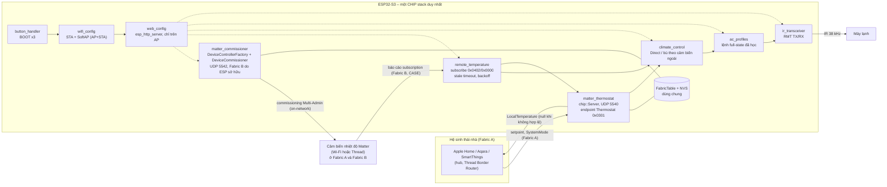

# Bộ điều khiển máy lạnh IR – Matter Thermostat (ESP32-S3)

Firmware ESP-IDF thuần (không Arduino, không ESPHome, không Home Assistant/MQTT/RainMaker/cloud) cho
ESP32-S3 N16R8:

- xuất hiện trong Apple Home, Aqara Home, SmartThings… dưới dạng **Matter Thermostat** (Tắt/Làm lạnh,
  Sưởi/Khô/Quạt chỉ khi profile máy lạnh đã học các chế độ đó);
- tự tạo **fabric riêng (Fabric B)** để ghép cảm biến nhiệt độ Matter đã có trong nhà bằng Multi-Admin,
  rồi **subscribe** trực tiếp nhiệt độ của cảm biến (kể cả cảm biến Thread qua Border Router sẵn có);
- điều khiển máy lạnh bằng **hồng ngoại học từ remote gốc** (RMT native của ESP-IDF);
- **nhấn BOOT 3 lần** để mở Wi-Fi cấu hình và trang web tiếng Việt tại `http://192.168.4.1`;
- lưu mọi cấu hình vào flash: mất điện không phải thiết lập lại.

> Trạng thái: toàn bộ mã nguồn đã viết và **build thành công** cho ESP32-S3; logic thuần đã có
> unit test chạy trên máy tính; giao diện web đã được kiểm thử tự động trong trình duyệt. Các phần cần
> phần cứng thật (Matter với hub, cảm biến, IR, nút bấm) **chưa được chạy trên thiết bị** – xem
> [mục 9](#9-đã-build-đã-thử-và-cần-phần-cứng-để-xác-nhận).

---

## Mục lục

1. [Kiến trúc](#1-kiến-trúc)
2. [Phiên bản SDK đã khóa](#2-phiên-bản-sdk-đã-khóa)
3. [Server + commissioner trên một CHIP stack: giới hạn SDK và giải pháp](#3-server--commissioner-trên-một-chip-stack-giới-hạn-sdk-và-giải-pháp)
4. [Phần cứng và đấu nối](#4-phần-cứng-và-đấu-nối)
5. [Build, nạp và xem log trên Windows (ESP-IDF Terminal)](#5-build-nạp-và-xem-log-trên-windows-esp-idf-terminal)
6. [Thiết lập từng bước](#6-thiết-lập-từng-bước)
7. [Hoạt động chi tiết](#7-hoạt-động-chi-tiết)
8. [Bảo mật](#8-bảo-mật)
9. [Đã build, đã thử và cần phần cứng để xác nhận](#9-đã-build-đã-thử-và-cần-phần-cứng-để-xác-nhận)
10. [Giới hạn đã biết](#10-giới-hạn-đã-biết)
11. [Cấu hình Kconfig](#11-cấu-hình-kconfig)
12. [Cấu trúc mã nguồn](#12-cấu-trúc-mã-nguồn)

---

## 1. Kiến trúc



Luồng dữ liệu chính:

| Đường | Mô tả |
|---|---|
| Hub → Thermostat | `SystemMode`, `OccupiedCoolingSetpoint` (và `OccupiedHeatingSetpoint` nếu có Sưởi) ghi vào endpoint Thermostat. Giá trị ngoài giới hạn/chế độ chưa học bị từ chối ngay ở callback PRE_UPDATE. |
| Thermostat → climate_control | Callback trên CHIP thread chỉ đưa sự kiện vào hàng đợi; tác vụ `climate` tính trạng thái máy lạnh mong muốn. |
| climate_control → IR | Trạng thái full-state (chế độ, nhiệt độ, quạt, đảo gió) → chọn lệnh **đã học** khớp nhất → hàng đợi phát IR (một chỗ chờ, lệnh mới nhất thắng, chống trùng, giãn cách tối thiểu). |
| Cảm biến → remote_temperature | Subscription Fabric B tới endpoint đã chọn; mỗi báo cáo hoặc keep-alive cập nhật “còn sống”. Quá hạn → không khả dụng. |
| remote_temperature → Thermostat | `LocalTemperature` = nhiệt độ ngoài, **null** khi không có giá trị hợp lệ/mới. |

Ba giá trị được tách riêng xuyên suốt: **nhiệt độ đặt của người dùng** (Matter), **nhiệt độ phòng
nhận được** (cảm biến) và **setpoint thực tế gửi qua IR** (sau thuật toán) – cả ba hiển thị riêng trên web.

---

## 2. Phiên bản SDK đã khóa

| Thành phần | Phiên bản | Khóa bằng |
|---|---|---|
| ESP-IDF | **v6.0.2** (commit `7101770dc6db2667b3c477cc31365dd1acd6db4e`, GCC xtensa 15.2.0) | `main/idf_component.yml` (`idf: "==6.0.2"`), cảnh báo trong `CMakeLists.txt` nếu khác |
| espressif/esp_matter | **1.6.1** (component registry, `component_hash 7ba854953cc0…`, esp-matter commit `067ccbd1a4`) | `main/idf_component.yml` (`==1.6.1`) + `dependencies.lock` |
| connectedhomeip | commit **`b1902b39ac6734913ce5f4d2abf153693a50264b`** (đi kèm esp_matter 1.6.1) | do esp_matter 1.6.1 cố định |
| espressif/qrcode | 0.2.0 | `main/idf_component.yml` + `dependencies.lock` |
| Phụ thuộc gián tiếp | cjson 1.7.19~2, esp_delta_ota 1.1.4, esp_encrypted_img 2.7.0, esp_secure_cert_mgr 2.9.3, mdns 1.14.1 | `dependencies.lock` |

Lý do chọn: esp_matter 1.6.1 là bản phát hành mới nhất hỗ trợ IDF v6.0.x; bản connectedhomeip đi kèm
có đủ `DeviceControllerFactory` với tham số dùng chung FabricTable/kho khóa của server (xem mục 3) và
`ReadClient::SendAutoResubscribeRequest`. Mọi API dùng trong mã đã được đối chiếu với mã nguồn SDK
trong `managed_components/` (không có API hay tùy chọn Kconfig tự đặt ra).

---

## 3. Server + commissioner trên một CHIP stack: giới hạn SDK và giải pháp

### 3.1 Bằng chứng giới hạn

Con đường “chính thức” của esp-matter cho controller **không dùng được cùng lúc với server**:

- `managed_components/espressif__esp_matter/components/esp_matter_controller/Kconfig`, dòng 16–18:
  ```
  config ESP_MATTER_COMMISSIONER_ENABLE
      bool "Enable matter commissioner"
      depends on ESP_MATTER_CONTROLLER_ENABLE && !ESP_MATTER_ENABLE_MATTER_SERVER
  ```
- `.../esp_matter_controller/CMakeLists.txt`, dòng 22–27: khi `CONFIG_ESP_MATTER_ENABLE_MATTER_SERVER`
  bật, `esp_matter_controller_client.cpp`, `..._credentials_issuer.cpp`, `..._group_settings.cpp`,
  `..._icd_client.cpp` bị loại khỏi build. `matter_controller_client` vốn tự tạo factory, storage và
  FabricTable riêng – nếu ép chạy song song với `chip::Server` sẽ thành hai bộ storage/FabricTable tranh
  nhau và hai stack mở cổng UDP.

Trong connectedhomeip có các điểm bắt buộc khi chạy server và commissioner trong cùng tiến trình:

- `src/include/platform/CHIPDeviceConfig.h` (≈ dòng 895): `CHIP_CONFIG_UNSAFE_SUBSCRIPTION_EXCHANGE_MANAGER_USE`
  “Needs to be 1 when … ENABLE_BOTH_COMMISSIONER_AND_COMMISSIONEE” (issue #23625): mỗi `ReadHandler` phải
  nhớ `ExchangeManager` của chính nó (`src/app/ReadHandler.cpp` dòng 62 và 302), vì
  `DeviceControllerFactory` khởi tạo lại singleton `InteractionModelEngine` với ExchangeManager của controller.
- `src/app/ReadHandler.cpp` dòng 80–89: `ReadHandler` được **khôi phục** từ subscription đã lưu
  (`CHIP_CONFIG_PERSIST_SUBSCRIPTIONS`) không gán `mExchangeMgr` → dòng 302 sẽ dùng con trỏ null.
- `src/app/InteractionModelEngine.cpp` dòng 1947–1950: `SetDataModelProvider()` gọi
  `VerifyOrDie(mReadHandlers.begin() == mReadHandlers.end())` – factory phải khởi tạo **trước** khi có bất
  kỳ subscription nào tới server.

### 3.2 Giải pháp đã triển khai

Theo đúng mô hình “combined server/commissioner” của connectedhomeip
(`examples/platform/linux/CommissionerMain.cpp`, dùng bởi tv-app/fabric-admin):

1. `esp_matter::set_server_init_params()` trao cho esp-matter một `CommonCaseDeviceServerInitParams` do ứng
   dụng giữ → ứng dụng biết chính xác storage, kho khóa, FabricTable của server.
2. Ngay sau `esp_matter::start()`, **trên CHIP thread** và trước khi Wi-Fi lên (chưa thể có subscription),
   `DeviceControllerFactory::Init()` được gọi với **cùng** `FabricTable`, `PersistentStorageDelegate`,
   `OperationalKeystore`, `OpCertStore`, `SessionKeystore`, `SessionResumptionStorage`,
   `GroupDataProvider`, `DataModelProvider` của server; cổng UDP riêng 5542; `enableServerInteractions=false`;
   `preventDnssdPortOverwrite=true` (không đè quảng bá DNS-SD của server 5540).
3. `main/matter_project_config.h`: `CHIP_CONFIG_UNSAFE_SUBSCRIPTION_EXCHANGE_MANAGER_USE 1`;
   `sdkconfig.defaults`: `CONFIG_ENABLE_PERSIST_SUBSCRIPTIONS=n`. Mã có `static_assert`/`#error` để không thể
   build sai cấu hình này.
4. Fabric B: khóa gốc P-256, RCAC (không ICAC), IPK, Fabric ID và Node ID controller ngẫu nhiên, lưu ở NVS
   namespace `ac_fabb`. Lần khởi động sau tìm lại đúng fabric (`FindFabric(rootPubKey, fabricId)`) và dùng lại
   `fabricIndex` – **không tạo fabric mới sau mỗi lần reboot**. Fabric B có nhãn “ESP AC sensor link” và
   không được tính là “hệ sinh thái nhà” (cửa sổ ghép thermostat tự mở khi chưa có fabric nhà nào).
5. Commissioning cảm biến: `PairDevice(..., DiscoveryType::kDiscoveryNetworkOnly)` (chỉ on-network,
   BLE tắt), xác thực thiết bị bằng **75 PAA production** nhúng sẵn (bản sao DCL trong connectedhomeip,
   nguồn và SHA-256 ở `components/matter_commissioner/paa/README.md`) – không cần Internet.

Mốc 1 (build khung server + commissioner) là commit `bd72683`; log khởi động sẽ in
`commissioner ready: fabric index …, fabric 0x…, node 0x… (created|restored)`.

---

## 4. Phần cứng và đấu nối

Bo tham chiếu: ESP32-S3 N16R8 (flash 16 MB QIO, PSRAM 8 MB octal). **Không dùng GPIO33–37** (PSRAM
octal), tránh chân strapping GPIO0/3/45/46 cho ngoại vi khác.

| Chức năng | Chân mặc định | Ghi chú |
|---|---|---|
| LED phát IR | **GPIO4** → transistor/MOSFET | Mức cao = LED sáng (đổi bằng `APP_IR_TX_INVERT`) |
| Đầu thu IR 38 kHz (TSOP38238, VS1838B…) | **GPIO5** | Ngõ ra tích cực mức thấp (mặc định); pull-up nội đã bật |
| Nút BOOT | **GPIO0** | Có sẵn trên bo, tích cực mức thấp |
| Cảm biến cục bộ SHT4x/SHT3x (tùy chọn) | SDA **GPIO8**, SCL **GPIO9** | Địa chỉ 0x44, chỉ dùng làm dự phòng |
| LED trạng thái (tùy chọn) | tắt (`-1`) | Sáng khi Wi-Fi cấu hình đang mở |

Mạch phát IR (dòng xung LED lớn hơn khả năng của GPIO, phải qua transistor):

```
 5V ──┬──────────────┐
      │            [R_LED 22–33 Ω]
     ===100 µF       │
      │            LED IR 940 nm (anode lên trên)
 GND ─┘              │
                     C
 GPIO4 ──[1 kΩ]── B  NPN (S8050/2N2222)   hoặc  GPIO4 ──[100 Ω]── G  N-MOSFET logic-level (AO3400)
                     E                                                 S ── GND, D ── catốt LED
                    GND
```

- Với 5 V, LED Vf ≈ 1,3 V, R = 33 Ω → đỉnh ≈ 100 mA; sóng mang chỉ sáng 33 % chu kỳ và chỉ trong vài trăm
  ms. Kiểm tra dòng xung cho phép của LED cụ thể. Có thể dùng 2 LED nối tiếp để tăng tầm.
- Đầu thu IR: VCC 3,3 V (đặt 100 Ω nối tiếp + 4,7 µF như datasheet TSOP), GND, OUT → GPIO5. **Đừng** cấp
  5 V cho đầu thu vì ngõ ra sẽ kéo lên 5 V vào GPIO.
- Đặt đầu thu sao cho không “nhìn” thẳng LED phát (khi học, thiết bị không phát).

---

## 5. Build, nạp và xem log trên Windows (ESP-IDF Terminal)

### 5.1 Cài đặt (một lần)

1. Cài **ESP-IDF v6.0.2** bằng bộ cài chính thức của Espressif cho Windows (ESP-IDF Installation
   Manager), chọn đúng phiên bản `v6.0.2`, target `esp32s3`.
2. Bật đường dẫn dài của Windows (connectedhomeip có cây thư mục rất sâu): Group Policy *Enable Win32 long
   paths* hoặc registry `LongPathsEnabled=1`, và trong ESP-IDF Terminal:
   ```bat
   git config --global core.longpaths true
   ```
3. Đặt dự án ở đường dẫn **ngắn**, ví dụ `C:\ac`:
   ```bat
   git clone https://github.com/haxeko/air-connditioner-control-matter.git C:\ac
   ```

### 5.2 Build / flash / monitor

Mở **ESP-IDF Terminal** (shortcut CMD hoặc PowerShell do bộ cài v6.0.2 tạo), rồi:

```bat
cd C:\ac
```

```bat
idf.py set-target esp32s3
```

```bat
idf.py build
```

Lần build đầu, component manager tải `esp_matter 1.6.1` và các phụ thuộc đúng như `dependencies.lock`
(cần Internet; các lần sau không cần). Build toàn bộ connectedhomeip mất khá lâu (10–30 phút).

Nạp và xem log (thay `COM5` bằng cổng của bo; với cổng USB native của S3 thường là cổng “USB JTAG/serial”):

```bat
idf.py -p COM5 flash monitor
```

Thoát monitor: `Ctrl+]`. Chỉ nạp ứng dụng (giữ NVS: fabric, cảm biến, profile IR vẫn còn):
`idf.py -p COM5 app-flash`. Xóa sạch flash (mất **toàn bộ** ghép nối và profile):
`idf.py -p COM5 erase-flash`.

> Đã kiểm chứng build trên Linux (cùng IDF v6.0.2). Trên Windows, nếu gặp lỗi đường dẫn quá dài dù đã
> bật long paths, có thể build trong WSL2 Ubuntu với đúng các lệnh trên (`idf.py -p /dev/ttyACM0 …` qua
> usbipd).

### 5.3 Test trên máy tính (không cần bo)

```bash
make -C test/host
```

```bash
python3 test/web/mock_server.py 8080
```

Sau đó mở `http://127.0.0.1:8080/` để xem giao diện với dữ liệu giả, hoặc chạy test tự động (cần Node.js +
Playwright): `node test/web/ui_test.js http://127.0.0.1:8080/`.

---

## 6. Thiết lập từng bước

### Bước 1 – Lấy mật khẩu Wi-Fi cấu hình

Mỗi thiết bị có SSID riêng `AC-Matter-XXXX` (4 ký tự cuối MAC) và **mật khẩu ngẫu nhiên riêng** tạo ở lần
khởi động đầu, lưu trong NVS. Mật khẩu **không** in ra log thường. Trong `idf.py monitor`, gõ:

```
secrets
```

Lệnh in SSID/mật khẩu Wi-Fi cấu hình và mã ghép Matter (kèm QR vẽ bằng ký tự). Các lệnh khác: `status`,
`portal`, `help`. Có thể đổi mật khẩu Wi-Fi cấu hình trên trang Wi-Fi (có hiệu lực ở lần mở sau).

### Bước 2 – Kết nối Wi-Fi nhà

1. Lần đầu (chưa có Wi-Fi) thiết bị tự phát Wi-Fi cấu hình. Các lần sau: **nhấn BOOT 3 lần nhanh** (trong
   1,5 s). 1–2 lần nhấn không làm gì; nhấn khi đang mở chỉ gia hạn thời gian.
2. Điện thoại kết nối `AC-Matter-XXXX`. Nếu điện thoại báo “không có Internet”, chọn **giữ kết nối**.
3. Mở `http://192.168.4.1` → tab **Wi-Fi** → *Quét mạng* → chọn mạng 2,4 GHz → nhập mật khẩu → **Lưu**.
4. Chờ “Đã kết nối mạng mới”. Nếu sai mật khẩu, sau 40 s thiết bị tự quay lại mạng cũ (nếu có).

Wi-Fi nhà (STA) luôn được giữ khi Wi-Fi cấu hình đang mở (chế độ AP+STA) nên Matter và subscription cảm
biến không bị gián đoạn.

### Bước 3 – Thêm thermostat vào ứng dụng nhà (Fabric A)

1. Tab **Nhà thông minh** → *Hiện mã ghép* (QR + mã 11 số). Khi thiết bị chưa thuộc hệ sinh thái nào, cửa
   sổ ghép tự mở 15 phút sau mỗi lần khởi động; có thể mở lại bằng nút *Mở cửa sổ ghép*.
2. Điện thoại ở cùng mạng Wi-Fi nhà. Trong Apple Home / Aqara Home / SmartThings: thêm thiết bị Matter, quét
   QR hoặc nhập mã.
3. Firmware dùng **chứng thư thiết bị thử nghiệm của SDK** (VID 0xFFF1): ứng dụng sẽ cảnh báo “thiết bị
   chưa được chứng nhận” – chọn vẫn thêm. Một số ứng dụng cần bật chế độ nhà phát triển/thiết bị thử nghiệm.
4. Muốn thêm vào hệ sinh thái thứ hai: dùng chức năng chia sẻ (Multi-Admin) của hệ sinh thái thứ nhất, hoặc
   mở lại cửa sổ ghép trên web.

### Bước 4 – Học lệnh IR và khóa profile

1. Tab **Máy lạnh** → *Tạo profile mới* (tên, bước nhiệt độ của remote 1 °C hoặc 0,5 °C, sóng mang 0 = 38 kHz).
2. Học lần lượt: **Tắt** (bắt buộc), **Làm lạnh** ở mọi nhiệt độ sẽ dùng (ví dụ 16–30 °C, quạt tự động),
   thêm Sưởi/Khô/Quạt và các mức quạt/đảo gió nếu muốn. Mỗi lệnh:
   - chọn trạng thái trên form; chỉnh remote tới **đúng** trạng thái đó;
   - *Bắt đầu học*, hướng remote vào đầu thu 5–30 cm, bấm một nút sao cho trạng thái cuối cùng trên remote
     đúng như đã chọn (remote máy lạnh gửi toàn bộ trạng thái mỗi lần bấm);
   - *Phát thử* → nếu máy lạnh phản hồi đúng (bíp, màn hình) → **Lưu**.
3. Phát thử lại các lệnh đã lưu, rồi **Khóa profile** (cần ít nhất Tắt + một lệnh Làm lạnh). Chỉ profile đã
   khóa mới được điều khiển tự động; profile khóa không học/xóa thêm được (mở khóa để sửa).
4. *Dùng profile này*. Nếu thanh cảnh báo báo giới hạn thay đổi, bấm **Khởi động lại để áp dụng**: giới hạn
   nhiệt độ và tính năng Sưởi của Matter Thermostat được tạo lúc khởi động theo profile đã khóa.

### Bước 5 – Ghép cảm biến nhiệt độ Matter (Fabric B)

1. Cảm biến đã nằm trong hệ sinh thái nhà. Trong ứng dụng đó, mở cài đặt của cảm biến và bật chế độ ghép /
   chia sẻ với hệ sinh thái khác (ví dụ Apple Home: *Bật chế độ ghép đôi*) để nhận **mã chia sẻ**.
2. Nhấn BOOT 3 lần, kết nối Wi-Fi cấu hình, tab **Cảm biến Matter** → nhập mã → *Bắt đầu ghép*.
   Nếu cảm biến là DIY/chứng thư thử nghiệm, đánh dấu *Cho phép thiết bị chưa được chứng nhận*.
3. ESP tìm cảm biến bằng DNS-SD trên mạng nhà, ghép vào Fabric B, đọc mọi endpoint có Temperature
   Measurement (0x0402) và hiển thị giá trị đọc thử. Chọn endpoint → **Lưu**. ESP subscribe ngay.
4. Cảm biến **vẫn hoạt động bình thường** trong hệ sinh thái cũ (Fabric A không bị sửa hay xóa).
5. Cảm biến Thread: cần Thread Border Router trong cùng LAN (HomePod/Apple TV, hub có chức năng Border
   Router…); ESP liên lạc bằng IPv6 qua Wi-Fi, không cần radio Thread, không đụng tới mạng Thread.

Gỡ cảm biến: *Gỡ cảm biến* gửi RemoveFabric chỉ cho fabric của ESP; cảm biến không bị reset, liên kết với
hub cũ giữ nguyên. Nếu cảm biến đã hỏng, dùng *Chỉ xóa liên kết trên ESP*.

### Bước 6 – Chọn cách điều khiển

Tab **Thuật toán**: *Direct* (gửi đúng nhiệt độ đặt) hoặc *Theo cảm biến ngoài*; vùng chết, giới hạn bù,
chu kỳ bù, lọc nhiễu, dự phòng cảm biến cục bộ, gửi lại sau mất điện → **Lưu**.

### Bước 7 – Thoát

Bấm **Thoát cấu hình** (hoặc để tự tắt sau ~10 phút không thao tác; không tự tắt khi đang ghép cảm biến,
học IR hoặc thử Wi-Fi mới).

---

## 7. Hoạt động chi tiết

### 7.1 Matter Thermostat (server, Fabric A)

- Endpoint Thermostat (device type 0x0301), FeatureMap: Cool, thêm Heat **chỉ khi** profile đã khóa có lệnh
  Sưởi; `ControlSequenceOfOperation` tương ứng (CoolingOnly / CoolingAndHeating).
- `SystemMode` chấp nhận: Off, Cool, và Heat/Dry/FanOnly chỉ khi đã học. Ghi sai bị từ chối.
- Giới hạn `AbsMin/AbsMax/Min/MaxCoolSetpointLimit` (và Heat) = dải nhiệt độ **đã học** của profile; chưa có
  profile khóa → 16–30 °C. Các giới hạn này không lưu NVS để profile luôn là nguồn đúng.
- `LocalTemperature` = nhiệt độ ngoài, cập nhật bằng `esp_matter::attribute::report()` trên CHIP thread;
  **null** khi không có giá trị hợp lệ/mới.
- Không có `ThermostatRunningState`/PI demand: IR một chiều, không đo được máy nén.
- Thông tin ghép (passcode, discriminator, SPAKE2+ verifier) **ngẫu nhiên riêng từng thiết bị**, sinh lần đầu
  và lưu ở NVS `ac_ident`. Không sao chép NVS giữa các thiết bị.

### 7.2 Nhiệt độ ngoài (Fabric B)

- Định danh cảm biến: Fabric ID + compressed fabric ID + Node ID + endpoint (lưu NVS `ac_sensor`), không
  dùng IP. Địa chỉ được tìm lại bằng DNS-SD operational mỗi lần CASE.
- Subscribe `MeasuredValue`, `Min/MaxMeasuredValue` với MinIntervalFloor 30 s, MaxIntervalCeiling 600 s
  (cảm biến ngủ có thể thương lượng dài hơn).
- Mất kết nối → resubscribe với **exponential backoff** 5 s … 300 s ± 20 %, luôn thiết lập CASE mới; có IP
  mới (Wi-Fi lên lại) → thử lại ngay.
- **Stale timeout** = max(ngưỡng tối thiểu 15 phút, 2 × MaxInterval đã thương lượng + 60 s). Báo cáo trống
  (keep-alive) cũng tính là còn sống: nhiệt độ không đổi **không** bị coi là mất cảm biến.
- Giá trị null, ngoài `Min/MaxMeasuredValue` của cảm biến hoặc ngoài −10…60 °C → không hợp lệ.
- Hết hạn → `LocalTemperature` = null, dừng bù; nếu cho phép và có cảm biến cục bộ hợp lệ → dùng cảm biến
  cục bộ. Không bao giờ tự tạo giá trị hay giữ giá trị cũ vô hạn. Sau reboot, nhiệt độ là “không khả dụng”
  cho tới báo cáo đầu tiên.

### 7.3 Điều khiển (climate_control)

- **Lệnh Tắt luôn ưu tiên**, phát ngay (không gộp); thuật toán không bao giờ tự bật máy lạnh.
- *Direct*: nhiệt độ đặt làm tròn theo bước của remote (làm lạnh làm tròn lên, sưởi làm tròn xuống).
- *Theo cảm biến ngoài* (chỉ Lạnh/Sưởi): trung vị 3 mẫu + lọc thông thấp theo thời gian; trong vùng chết
  thì giữ nguyên; ngoài vùng chết chỉnh **một bước** mỗi lần, cách nhau ít nhất *chu kỳ bù* (mặc định 10
  phút; lần đầu chờ một chu kỳ); độ bù ≤ giới hạn (mặc định 3 °C) và bị cắt theo dải đã học (chống tích lũy).
  Cảm biến không hợp lệ → độ bù về 0 (như Direct). Đổi chế độ hoặc Tắt → xóa độ bù.
- Thay đổi liên tiếp từ ứng dụng được gộp (mặc định 1,5 s) trước khi phát.
- Máy lạnh vẫn tự điều chỉnh theo cảm biến bên trong của nó; firmware **không** giả lập Follow-Me/I-Feel.

### 7.4 IR

- Học raw bằng RMT RX 1 MHz với *partial receive*: lệnh dài, nhiều đoạn (frame cách nhau > 12 ms vẫn được
  giữ đúng khoảng lặng), lặp lại. Bộ đệm không đủ → **báo lỗi**, không lưu bản bị cắt.
- Đầu thu giải điều chế nên **không đo được sóng mang**: sóng mang là cấu hình (mặc định 38 kHz, đổi theo
  profile).
- Lưu theo **full-state** (Tắt hoặc chế độ + nhiệt độ + quạt + đảo gió) trong phân vùng NVS riêng `irstore`.
  Profile raw **chỉ phát tổ hợp đã học**: thiếu đúng nhiệt độ → dùng nhiệt độ đã học gần nhất cùng chế độ;
  không bao giờ đổi sang chế độ khác.
- Hàng đợi phát: một chỗ chờ (lệnh full-state mới nhất thay lệnh cũ), bỏ lệnh trùng trong 1,5 s, giãn cách
  tối thiểu 600 ms, không phát khi đang học.
- Web phân biệt “đã phát IR” (LED đã phát) với “máy lạnh đã nhận” (không thể biết).
- Interface `ac_protocol_driver_t` (`components/ac_profiles/include/ac_protocol.h`) để thêm driver giao thức
  native sau này; hiện chỉ có driver RAW – không có encoder đa hãng tự chế.

---

## 8. Bảo mật

- Trang quản trị chỉ phục vụ kết nối tới **địa chỉ SoftAP** (kiểm tra địa chỉ cục bộ của socket, kể cả IPv4
  map IPv6) và chỉ khi cổng cấu hình đang mở; kết nối từ mạng nhà bị đóng ngay khi accept. Truy cập SoftAP
  cần mật khẩu WPA2 riêng của thiết bị.
- `Host` phải là địa chỉ AP (chống DNS rebinding); `Origin`/`Sec-Fetch-Site` khác nguồn bị từ chối; mọi API
  cần token ngẫu nhiên mỗi lần khởi động trong header `X-CSRF-Token` (trang khác nguồn không thể gửi header
  tùy biến khi không có CORS); thay đổi chỉ qua POST form, kiểm tra từng trường; thân yêu cầu ≤ 2 KB.
- CSP chặt (`script-src 'self'`, không inline script), `X-Frame-Options: DENY`, không cache.
- Không log mật khẩu Wi-Fi, mật khẩu AP, mã chia sẻ, passcode hay khóa riêng; mã ghép chỉ hiện theo yêu cầu
  trên web hoặc lệnh console `secrets`. Bộ đệm chứa mật khẩu/mã được xóa sau khi dùng.
- Chứng thư thiết bị là **chứng thư thử nghiệm** của SDK (xem giới hạn).

---

## 9. Đã build, đã thử và cần phần cứng để xác nhận

### 9.1 Đã build

- Toàn bộ firmware build sạch cho `esp32s3` với IDF v6.0.2 + esp_matter 1.6.1 (cờ cảnh báo mặc định của
  IDF, cảnh báo bị coi là lỗi): ảnh 1,66 MB (khe OTA 4 MB), DIRAM tĩnh 38,5 %.
- Mốc 1: server + commissioner Fabric B trên cùng CHIP stack build và link thành công.

### 9.2 Đã thử (không cần phần cứng)

| Hạng mục | Cách thử | Kết quả |
|---|---|---|
| Logic thuần: nút BOOT, mã IR & ghép đoạn, khóa/chọn lệnh full-state, thuật toán bù, stale/backoff/CRC SHT, kiểm tra cấu hình, JSON/form/UTF-8 của web | `make -C test/host` (gcc, AddressSanitizer + UBSan) | 25 339 kiểm tra đạt; test đột biến (cấy lỗi) đều bị phát hiện |
| Giao diện web: mọi trang, ghép cảm biến giả, học IR giả, khóa profile, điều khiển, thuật toán, chẩn đoán, thoát; SSID chứa HTML hiển thị như văn bản | `test/web/ui_test.js` + `mock_server.py` trong Chromium headless, màn hình 390×844 | Đạt, không lỗi JavaScript |
| Một/hai lần BOOT không mở cấu hình, ba lần mở; nhấn giữ hủy chuỗi; dội phím bị lọc | unit test `press_detector` | Đạt |
| Off không bị thuật toán ghi đè; không tự bật | unit test `climate_algo` | Đạt |
| Không phát tổ hợp raw chưa học, không đổi chế độ | unit test `ac_resolve` | Đạt |
| Khung IR dài/nhiều đoạn không bị cắt âm thầm | unit test `ir_code`/`ir_capture` | Đạt |

### 9.3 Cần phần cứng để xác nhận

| Mốc / kiểm tra | Trạng thái |
|---|---|
| 1. Khởi động server + commissioner trên S3 thật (log “commissioner ready”) | Đã build; cần chạy trên bo |
| 2. Ghép cảm biến thật bằng Multi-Admin, đọc và subscribe | Đã cài đặt; cần cảm biến + hub |
| 3. Reboot/mất điện: tự subscribe lại, không cần ghép lại; fabric và profile còn nguyên | Đã cài đặt (NVS); cần thiết bị |
| 4. Thêm thermostat vào Apple Home/Aqara/SmartThings, cập nhật nhiệt độ, nhận setpoint | Đã cài đặt; cần hub |
| 5. BOOT × 3 trên GPIO0 thật, AP+STA, web trên điện thoại | Logic + UI đã thử; cần bo + điện thoại |
| 6. Thu/phát IR với remote và máy lạnh thật | Đã cài đặt; cần mạch IR + máy lạnh |
| 7. Thuật toán trên phòng thật; mất cảm biến không phát lệnh sai | Logic đã thử; cần phần cứng |
| AP+STA không làm mất đường mạng tới cảm biến | Thiết kế giữ STA; cần đo thực tế |
| Cảm biến vẫn hoạt động ở hệ sinh thái cũ | Chỉ thêm fabric; cần xác nhận với hub |
| Không có Internet nhưng còn LAN/Border Router: điều khiển cục bộ vẫn chạy | Không dùng dịch vụ Internet nào; cần xác nhận |

Ghi chú: firmware **không** khẳng định vẫn đọc được cảm biến Thread khi hub là Border Router duy nhất và hub
bị tắt – khi đó không còn đường IPv6 tới mạng Thread.

### 9.4 Quy trình nghiệm thu trên phần cứng

Mở `idf.py monitor` trong suốt quá trình; lệnh `status` in nhanh trạng thái.

1. **Khởi động hai vai trò** – log có `thermostat endpoint 1 …` và
   `commissioner ready: fabric index …, fabric 0x…, node 0x… (created)`; lần khởi động sau là `(restored)`
   với cùng fabric ID (không tạo fabric mới).
2. **BOOT** – nhấn 1 lần, rồi 2 lần: không có log `portal open`. Nhấn 3 lần trong 1,5 s: log
   `portal open: SSID AC-Matter-XXXX`. Nhấn 3 lần lần nữa: `portal already open: lifetime extended`. Giữ nút
   lâu: không có gì xảy ra (không factory reset).
3. **Ghép cảm biến** – theo bước 5; trang Cảm biến hiển thị endpoint và giá trị đọc thử; sau khi Lưu, trạng
   thái “Đã subscribe”, log `subscription … established: interval a..b s, stale after c s`.
4. **Cảm biến vẫn chạy ở hệ sinh thái cũ** – kiểm tra cảm biến vẫn cập nhật trong ứng dụng gốc.
5. **AP+STA** – khi đang mở cấu hình, ứng dụng nhà vẫn điều khiển được thermostat và nhiệt độ vẫn cập nhật
   (tuổi dữ liệu trên Tổng quan không tăng quá chu kỳ báo cáo).
6. **Thermostat** – đổi nhiệt độ đặt/chế độ trong ứng dụng nhà: trang Tổng quan hiển thị “Trạng thái cần gửi
   qua IR”, sau ~1,5 s “Đã phát IR”; máy lạnh bíp. Đặt nhiệt độ ngoài dải đã học bị ứng dụng từ chối.
7. **Mất điện** – rút điện, cắm lại: thermostat vẫn trong ứng dụng nhà, cảm biến tự subscribe lại (không ghép
   lại), profile IR còn nguyên, nhiệt độ hiển thị “Không khả dụng” cho tới báo cáo đầu tiên.
8. **Mất cảm biến** – tắt nguồn cảm biến: sau thời gian “Coi là mất sau” trên trang Cảm biến, `LocalTemperature`
   trong ứng dụng nhà thành trống/không rõ, lý do thuật toán “Không có nhiệt độ hợp lệ: ngừng bù”, setpoint IR
   trở về đúng nhiệt độ đặt (không phát lệnh bù sai).
9. **Off ưu tiên** – ở chế độ Theo cảm biến ngoài, phòng nóng, chọn Tắt trong ứng dụng: IR Tắt phát ngay; chờ
   quá chu kỳ bù: không có lệnh IR nào khác.
10. **Không phát tổ hợp chưa học** – đặt nhiệt độ chưa học: thiết bị phát nhiệt độ đã học gần nhất và ghi
    “dùng nhiệt độ đã học gần nhất”; chế độ chưa học không chọn được.
11. **Không Internet** – rút dây WAN của router: điều khiển từ điện thoại trong mạng nhà và cập nhật nhiệt độ
    cảm biến vẫn hoạt động (điều khiển từ xa ngoài nhà thì phụ thuộc hub của hệ sinh thái).

---

## 10. Giới hạn đã biết

- **Chứng thư thử nghiệm** (DAC/PAI ví dụ của SDK, VID 0xFFF1): ứng dụng nhà cảnh báo thiết bị chưa chứng
  nhận. Sản phẩm thật cần DAC/PAI riêng (phân vùng `fctry`/esp_secure_cert) và chứng nhận CSA.
- Fan/swing chỉ điều khiển trên web: cluster Thermostat không có mô hình chuẩn cho chúng; không xuất qua
  Matter để tránh hành vi khác nhau giữa các nền tảng.
- Thay đổi giới hạn/chế độ của profile chỉ áp dụng cho Matter sau khi khởi động lại (cấu trúc endpoint được
  tạo lúc khởi động).
- Cảm biến ICD dạng LIT (ngủ rất lâu, cần check-in) chưa được xử lý riêng; cảm biến SIT/thường được hỗ trợ.
- Cửa sổ ghép cơ bản tối đa 15 phút (giới hạn của chuẩn); hết thời gian thì mở lại trên web.
- Chỉ Wi-Fi 2,4 GHz; khi STA ở kênh khác, SoftAP theo kênh của STA (giới hạn phần cứng một radio).
- Khi đang học IR, lệnh phát bị hoãn tới khi học xong (tránh tự thu tín hiệu của mình).

---

## 11. Cấu hình Kconfig

`idf.py menuconfig` → **AC Matter IR controller**:

| Nhóm | Tùy chọn chính (mặc định) |
|---|---|
| GPIO | `APP_IR_TX_GPIO` (4), `APP_IR_TX_INVERT` (n), `APP_IR_RX_GPIO` (5), `APP_IR_RX_ACTIVE_LOW` (y), `APP_BOOT_BUTTON_GPIO` (0), `APP_BOOT_BUTTON_ACTIVE_LOW` (y), `APP_STATUS_LED_GPIO` (−1) |
| IR | `APP_IR_CARRIER_HZ` (38000), `APP_IR_CARRIER_DUTY_PERCENT` (33), `APP_IR_RX_IDLE_US` (12000), `APP_IR_RX_GLITCH_NS` (2500), `APP_IR_LEARN_END_GAP_MS` (400), `APP_IR_LEARN_TIMEOUT_S` (20), `APP_IR_MAX_LEVELS` (2048), `APP_IR_MAX_SEGMENTS` (16), `APP_IR_TX_MIN_GAP_MS` (600), `APP_IR_TX_DUPLICATE_WINDOW_MS` (1500) |
| Nút BOOT | `APP_BUTTON_DEBOUNCE_MS` (40, 30–50), `APP_BUTTON_PRESS_COUNT` (3), `APP_BUTTON_WINDOW_MS` (1500), `APP_BUTTON_MAX_PRESS_MS` (700) |
| Cổng cấu hình | `APP_AP_SSID_PREFIX` ("AC-Matter-"), `APP_AP_TIMEOUT_MIN` (10), `APP_AP_CHANNEL` (6), `APP_AP_MAX_CONN` (2), `APP_WIFI_CONNECT_TIMEOUT_S` (40) |
| Matter | `APP_COMMISSIONER_UDP_PORT` (5542), `APP_COMMISSIONING_WINDOW_S` (900), `APP_SENSOR_MIN_INTERVAL_S` (30), `APP_SENSOR_MAX_INTERVAL_S` (600), `APP_SENSOR_RETRY_MIN_S` (5), `APP_SENSOR_RETRY_MAX_S` (300), `APP_DEVICE_NAME` |
| Cảm biến cục bộ | `APP_LOCAL_SENSOR_NONE/SHT4X/SHT3X`, `..._SDA_GPIO` (8), `..._SCL_GPIO` (9), `..._PERIOD_S` (60) |
| Thử nghiệm | `APP_TEST_SIMULATED_SENSOR` (**n**) – nguồn nhiệt độ giả lập, chỉ để thử trên bàn, hiển thị rõ “GIẢ LẬP” |

Bảng phân vùng (`partitions.csv`): `nvs` 128 KB (Wi-Fi, Matter, cấu hình), `ota_0`/`ota_1` 4 MB, `irstore`
512 KB (lệnh IR), `fctry` 24 KB (dành cho dữ liệu nhà máy).

---

## 12. Cấu trúc mã nguồn

```
main/                    app_main.cpp (thứ tự khởi động, nối các module), app_console.c (secrets/status/portal),
                         Kconfig.projbuild, matter_project_config.h, idf_component.yml
components/
  app_state/             nhật ký lỗi gần nhất, cờ "bận" (ghép, học IR) giữ cổng cấu hình mở
  config_store/          NVS (2 phân vùng), app_config_t + kiểm tra hợp lệ
  matter_thermostat/     node + endpoint Thermostat, dữ liệu ghép riêng từng thiết bị, cửa sổ ghép, QR
  matter_commissioner/   Fabric B: issuer (RCAC/NOC/IPK), kho PAA offline, ghép/đọc/gỡ cảm biến
  remote_temperature/    subscription cảm biến, stale/backoff, cảm biến cục bộ SHT4x/SHT3x
  climate_control/       thuật toán Direct/bù (thuần C) + tác vụ điều khiển
  ac_profiles/           mô hình trạng thái full-state, profile, resolver, interface driver giao thức
  ir_transceiver/        RMT học/phát, định dạng mã IR, ghép đoạn
  button_handler/        phát hiện BOOT × N (thuần C) + tác vụ đọc nút
  wifi_config/           SoftAP/AP+STA, mật khẩu AP riêng, đổi Wi-Fi qua driver CHIP + rollback
  web_config/            esp_http_server, API, kiểm soát truy cập, giao diện offline (www/, nhúng gzip)
test/host/               unit test gcc cho phần thuần
test/web/                mock API + test trình duyệt cho giao diện
tools/                   gen_paa_bundle.py, gzip_asset.py (chạy tự động khi build)
```
