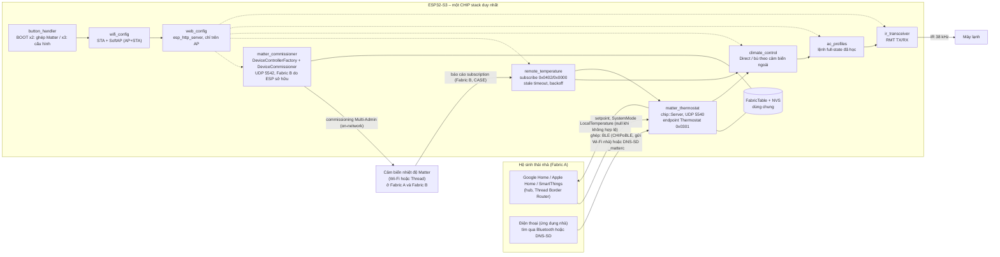

# Bộ điều khiển máy lạnh IR – Matter Thermostat (ESP32-S3)

Firmware ESP-IDF thuần (không Arduino, không ESPHome, không Home Assistant/MQTT/RainMaker/cloud) cho
ESP32-S3 N16R8:

- xuất hiện trong Google Home, Apple Home, SmartThings, Alexa, Aqara Home, Home Assistant… dưới dạng
  **máy lạnh / Matter Thermostat** tên **`May lanh IR v1.6.0`** (Tắt/Làm lạnh, Sưởi/Khô/Quạt khi profile máy
  lạnh có các chế độ đó; tốc độ quạt và đảo gió qua cluster Fan Control);
- tự tạo **fabric riêng (Fabric B)** để ghép cảm biến nhiệt độ Matter đã có trong nhà bằng Multi-Admin,
  rồi **subscribe** trực tiếp nhiệt độ của cảm biến (kể cả cảm biến Thread qua Border Router sẵn có);
- điều khiển máy lạnh bằng hồng ngoại (RMT native của ESP-IDF): **bấm remote một lần để tự nhận diện giao
  thức** (thư viện IRremoteESP8266, hơn 80 giao thức máy lạnh) rồi firmware tự tạo mọi lệnh, hoặc **học từng
  lệnh từ remote gốc** cho máy không có trong thư viện;
- **vẫn dùng remote gốc được**: mắt thu luôn nghe, bấm remote thì trạng thái mới (bật/tắt, chế độ, nhiệt độ,
  quạt, đảo gió) hiện lên Apple Home/Google Home… và lệnh sau từ ứng dụng nối tiếp đúng trạng thái đó;
- **nhấn BOOT 2 lần** để vào **chế độ ghép Matter** (LED RGB nháy xanh dương): ứng dụng nhà tìm thấy
  thiết bị **qua Bluetooth** (và qua Wi-Fi nhà nếu ESP đã vào mạng), thêm bằng **mã QR hoặc mã 11 số**;
  ứng dụng tự gửi Wi-Fi nhà cho ESP qua Bluetooth;
- **nhấn BOOT 3 lần** để mở Wi-Fi cấu hình và trang web tiếng Việt tại `http://192.168.4.1`;
- **giữ BOOT 10 giây rồi thả** để rời khỏi mọi ứng dụng nhà (giữ Wi-Fi, cảm biến, profile); **giữ 20 giây** để
  đặt lại gốc; cả hai cũng làm được trên web;
- **cập nhật firmware ngay trên trang web** (tải file `.bin`), không cần dây nạp; firmware mới lỗi thì tự quay
  về bản cũ;
- **tự phục hồi và tự báo lỗi**: treo thì watchdog khởi động lại; lỗi nghiêm trọng để lại báo cáo (tác vụ, vị trí)
  đọc được trên trang Chẩn đoán;
- lưu mọi cấu hình vào flash: mất điện không phải thiết lập lại;
- mọi tên thiết bị phát ra đều có **hậu tố phiên bản firmware** (`v1.6.0`): tên Matter, tên Bluetooth
  `AC-XXXX-v1.6.0`, Wi-Fi cấu hình `AC-Matter-XXXX-v1.6.0` – nhìn tên là biết thiết bị đang chạy bản nào.

### Có gì mới trong v1.6.0

Bản rà soát và tối ưu (firmware và [mạch in v1.4](hardware/ac-ir-s3/README.md)). Cách điều khiển máy lạnh không
đổi; thiết bị tự phục hồi tốt hơn và nói được vì sao nó khởi động lại.

Độ tin cậy và chẩn đoán:

- **Treo thì tự khởi động lại**: một tác vụ chiếm CPU quá 15 giây làm thiết bị panic và khởi động lại (trước đây
  watchdog chỉ in cảnh báo ra cổng serial, thiết bị vẫn treo).
- **Báo cáo sự cố**: khi firmware lỗi nghiêm trọng (exception, abort, watchdog), thiết bị lưu core dump vào phân
  vùng `coredump` trước khi khởi động lại. Tab **Chẩn đoán → Sự cố khởi động lại** (và lệnh console `diag`) hiện
  tác vụ gây lỗi, vị trí và chuỗi địa chỉ gọi hàm – chỉ là địa chỉ trong chương trình, không có nội dung bộ nhớ.
  `python tools/decode_backtrace.py <địa chỉ…>` đổi các địa chỉ đó thành tên hàm bằng file
  `ac_matter_ir_v1.6.0_symbols.txt.gz` (không cần ESP-IDF). Phân vùng này chỉ có trên bo nạp file `full` từ
  v1.6.0, hoặc nạp thêm file bảng phân vùng (xem [firmware/README.md](firmware/README.md)); bo chỉ cập nhật file
  app thì chạy bình thường, chỉ là không lưu báo cáo.
- **Ngăn xếp của từng tác vụ** (số byte còn trống ít nhất từ lúc khởi động) trên trang Chẩn đoán và lệnh `diag`:
  thấy ngay tác vụ nào sát giới hạn khi chạy trên bo thật.
- **Identify**: ứng dụng nhà bấm “nhận diện thiết bị” thì LED nháy **trắng**.

Sửa lỗi (các mục còn lại của lần rà soát trước):

- Phát IR bị quá hạn: kênh phát được dừng trước khi bộ đệm lệnh bị giải phóng (trước đây ngắt phát có thể còn đọc
  vùng nhớ đã trả lại).
- Vừa phát một lệnh, người dùng bấm remote gốc đổi trạng thái, rồi ứng dụng nhà lại yêu cầu đúng lệnh vừa phát
  (trong 1,5 giây): lệnh không còn bị coi là trùng và bỏ qua.
- Khởi động lại từ trang web (kể cả sau khi cập nhật firmware): lệnh IR đang chờ được phát nốt và trạng thái máy
  lạnh được lưu trước khi khởi động lại (trước đây có thể mất thay đổi của 10 giây cuối).
- Thuộc tính `ControlSequenceOfOperation` không còn ghi được sang kiểu mà máy lạnh không có (ví dụ “có sưởi” với
  profile chỉ làm lạnh); giá trị cũ sai được sửa lúc khởi động.
- Cổng cấu hình khởi tạo lỗi không còn làm thiết bị khởi động lại liên tục: thermostat và IR vẫn chạy.

Cấu hình:

- Tắt hẳn bộ mã ghép thử nghiệm của SDK (`CONFIG_ENABLE_TEST_SETUP_PARAMS=n`): không còn đường nào quay về
  passcode `20202021` (thiết bị vốn dùng mã riêng từng máy).
- Chọn GPIO không dùng được trên N16R8 (flash/PSRAM 26–37, UART0 43/44, chân strapping cho ngõ ra IR, hai chức
  năng trùng chân) bị từ chối **lúc build** thay vì hỏng lúc chạy.

### Có gì mới trong v1.5.0

Tính năng mới:

- **Cập nhật firmware qua web** (tab Chẩn đoán → *Cập nhật firmware*): chọn file `ac_matter_ir_vX.Y.Z_app_0x40000.bin`,
  thiết bị ghi vào khe OTA còn lại, kiểm tra nội dung rồi khởi động lại. Mọi dữ liệu được giữ. Firmware mới chạy
  thử 60 giây; nếu thiết bị reset trong thời gian đó, bootloader quay về bản cũ. Chi tiết ở [mục 7.5](#75-cập-nhật-firmware-và-đặt-lại).
- **Rời khỏi ứng dụng nhà ngay trên thiết bị**: gỡ từng hệ sinh thái hoặc tất cả (tab Nhà thông minh), hoặc
  **giữ BOOT 10 giây rồi thả** (LED nháy đỏ nhanh). Dùng khi hub đã mất hoặc đã xóa thiết bị lúc ESP mất mạng.
  Wi-Fi, cảm biến, profile IR và cài đặt được giữ; chế độ ghép tự bật lại.
- **Đặt lại gốc**: tab Chẩn đoán → *Đặt lại gốc*, hoặc **giữ BOOT 20 giây** (LED đỏ sáng liên tục). Xóa Wi-Fi, mọi
  fabric, cảm biến và cài đặt; giữ mã ghép Matter (tem QR đã in vẫn dùng được) và profile IR.

Sửa lỗi (tìm thấy khi rà soát mã nguồn):

- **Không còn tự phát lệnh IR**: trước đây, sau khi lưu/khóa/chọn profile (hoặc sau khi NVS bị xóa), thiết bị tự
  phát trạng thái thermostat trong vòng 30 giây – thường là lệnh *Tắt* – dù không ai yêu cầu. Nay khi chưa biết
  máy lạnh đang ở trạng thái nào, thiết bị coi như đã khớp và chỉ phát khi có thay đổi thật. Lúc khởi động cũng
  không bao giờ phát (trừ khi bật *Gửi lại trạng thái cuối sau khi mất điện*).
- **Bật máy kèm đổi chế độ** từ ứng dụng nhà (lệnh On và ghi SystemMode đi sát nhau) không còn có thể bị ghi đè
  bằng chế độ của lần bật trước.
- Ứng dụng nhà ghi lại đúng giá trị đang có (cảnh/tự động hóa lặp lại) không còn làm lùi chu kỳ bù theo cảm biến.
- Đổi Wi-Fi mà mất điện giữa lúc thử kết nối: lần khởi động sau tự quay về mạng cũ.
- Bộ thu IR: loại bỏ một tình huống tranh chấp hiếm giữa ngắt thu và việc dừng bộ thu (có thể gây khởi động lại).

### Có gì mới trong v1.4.0

- **Đồng bộ khi bấm remote gốc**: v1.3.0 chỉ dùng mắt thu lúc học/nhận diện, nên bấm remote thì máy lạnh đổi
  nhưng ESP và ứng dụng nhà không biết. Từ v1.4.0, khi profile đang dùng **đã khóa**, mắt thu nghe liên tục:
  lệnh của remote được giải mã theo profile (profile thư viện: đúng giao thức, ví dụ `SHARP_AC`; profile học
  thủ công: so với các lệnh đã học), rồi trạng thái mới được hiển thị trong ứng dụng nhà (SystemMode,
  nhiệt độ đặt, On/Off, quạt, đảo gió) **mà không phát lại IR**. Lệnh tiếp theo từ ứng dụng dùng trạng thái
  đó làm trạng thái trước (quan trọng với giao thức “đảo trạng thái” như Sharp). Chi tiết ở
  [mục 7.4](#74-ir), tắt được ở tab Thuật toán (*Đồng bộ khi bấm remote gốc*).
- Trang Máy lạnh có dòng **Remote gốc**: trạng thái remote đặt lần cuối, hoặc lý do lệnh cuối bị bỏ qua (ví dụ
  `giao thức NEC, profile dùng SHARP_AC` khi bấm remote TV). Lệnh `status` có dòng `Remote  :`.
- Thêm kiểm tra trên máy tính: chuỗi bấm remote Sharp (bật, đổi nhiệt độ, quạt, Sưởi, Khô, Tắt) qua mô phỏng
  mắt thu được đọc lại đúng trạng thái; trạng thái remote → trạng thái thermostat; sau khi bấm remote thuật
  toán không phát lại lệnh (cả chế độ Theo cảm biến ngoài).

### Có gì mới trong v1.3.0

- **Nhận diện remote tự động**: tab Máy lạnh → *Bắt đầu nhận diện* → bấm một nút trên remote. Firmware giải
  mã tín hiệu bằng thư viện **IRremoteESP8266 v2.9.0** (ESP-IDF thuần, không Arduino; `components/irremote_esp8266`),
  cho biết giao thức (Daikin, Panasonic, LG, Samsung, Mitsubishi, Toshiba, Gree, Midea, Fujitsu, Sharp,
  Hitachi, Haier, Coolix…), model và trạng thái đọc được. Phát thử vài lệnh do firmware **tự tạo**, đúng thì
  *Lưu và dùng*: một **profile thư viện** tạo được mọi tổ hợp chế độ × nhiệt độ × tốc độ quạt × đảo gió, không
  phải học từng lệnh. Không nhận ra thì vẫn học từng lệnh như trước. Chi tiết ở [mục 7.4](#74-ir).
- Sửa một lỗi của thư viện gốc (lệnh Kelon luôn bị gửi ở chế độ Sưởi), ghi trong
  `components/irremote_esp8266/README.md`.
- Thêm 1 538 kiểm tra trên máy tính: lệnh của 28 giao thức máy lạnh được tạo ra, mô phỏng méo tín hiệu của mắt
  thu, rồi nhận diện lại đúng giao thức và trạng thái.

### Có gì mới trong v1.2.0

- **Chỉnh quạt và đảo gió từ ứng dụng nhà**: thiết bị là **Room Air Conditioner** (kèm loại Thermostat) với
  cluster **Fan Control** (tốc độ theo các mức quạt đã học, Auto, đảo gió lên/xuống) và **On/Off**. Chi tiết ở
  [mục 7.1](#71-matter-thermostat-server-fabric-a). Tên thiết bị: `May lanh IR v1.2.0`.

### Có gì mới trong v1.1.0

- **Sửa lỗi “LED nháy xanh dương nhưng ứng dụng không thấy thiết bị”**: bản v1.0.0 không có Bluetooth,
  chỉ quảng bá trên mạng IP (DNS-SD). Ứng dụng Matter tìm thiết bị mới chủ yếu qua Bluetooth, còn đường IP
  chỉ chạy khi ESP đã vào đúng Wi-Fi nhà, điện thoại cùng mạng 2.4 GHz/không bị cách ly, và người dùng
  quét mã. v1.1.0 bật **CHIPoBLE** (NimBLE): trong chế độ ghép ESP quảng bá đồng thời qua Bluetooth và
  DNS-SD, QR có cờ BLE + mạng, BOOT x2 hoạt động cả khi ESP chưa có Wi-Fi (ứng dụng gửi Wi-Fi qua
  Bluetooth). Quan trọng: esp-matter mặc định tắt hẳn Bluetooth khi bảng fabric không rỗng
  (`CONFIG_USE_BLE_ONLY_FOR_COMMISSIONING`), mà Fabric B riêng của ESP luôn có mặt – nên tùy chọn này
  được tắt, nếu không Bluetooth sẽ bị gỡ ngay khi khởi động.
- **Đặt lại tên thiết bị có hậu tố phiên bản**: ProductName/NodeLabel/DNS-SD `DN` = `May lanh IR v1.1.0`,
  VendorName `DIY` (v1.0.0 phát ra `TEST_PRODUCT`/`TEST_VENDOR` mặc định của SDK và NodeLabel trống), tên
  Bluetooth `AC-XXXX-v1.1.0`, SSID cấu hình `AC-Matter-XXXX-v1.1.0`. Khi khởi động, NodeLabel trống hoặc còn
  tên mặc định của bản cũ được đặt thành tên mới; tên đã đổi trong ứng dụng nhà được giữ nguyên.
- Quảng bá DNS-SD có thêm `DT=769` (Thermostat). SoftwareVersion Matter = 10100.
- Mã số 11 chữ số không đổi; nội dung QR đổi (thêm cờ Bluetooth) – tem QR in từ v1.0.0 vẫn dùng được
  qua mạng Wi-Fi nhà, in lại tem để ứng dụng tìm qua Bluetooth.

> Trạng thái: toàn bộ mã nguồn đã viết và **build thành công** cho ESP32-S3; logic thuần đã có
> unit test chạy trên máy tính; giao diện web đã được kiểm thử tự động trong trình duyệt. Các phần cần
> phần cứng thật (Matter với hub, cảm biến, IR, nút bấm) **chưa được chạy trên thiết bị** – xem
> [mục 9](#9-đã-build-đã-thử-và-cần-phần-cứng-để-xác-nhận).

---

## Mục lục

1. [Kiến trúc](#1-kiến-trúc)
2. [Phiên bản SDK đã khóa](#2-phiên-bản-sdk-đã-khóa)
3. [Server + commissioner trên một CHIP stack: giới hạn SDK và giải pháp](#3-server--commissioner-trên-một-chip-stack-giới-hạn-sdk-và-giải-pháp)
4. [Phần cứng và đấu nối](#4-phần-cứng-và-đấu-nối)
5. [Build, nạp và xem log trên Windows (ESP-IDF Terminal)](#5-build-nạp-và-xem-log-trên-windows-esp-idf-terminal)
6. [Thiết lập từng bước](#6-thiết-lập-từng-bước)
7. [Hoạt động chi tiết](#7-hoạt-động-chi-tiết)
8. [Bảo mật](#8-bảo-mật)
9. [Đã build, đã thử và cần phần cứng để xác nhận](#9-đã-build-đã-thử-và-cần-phần-cứng-để-xác-nhận)
10. [Giới hạn đã biết](#10-giới-hạn-đã-biết)
11. [Cấu hình Kconfig](#11-cấu-hình-kconfig)
12. [Cấu trúc mã nguồn](#12-cấu-trúc-mã-nguồn)

---

## 1. Kiến trúc



Luồng dữ liệu chính:

| Đường | Mô tả |
|---|---|
| Hub → Thermostat | `SystemMode`, `OccupiedCoolingSetpoint` (và `OccupiedHeatingSetpoint` nếu có Sưởi) ghi vào endpoint Thermostat. Giá trị ngoài giới hạn/chế độ chưa học bị từ chối ngay ở callback PRE_UPDATE. |
| Thermostat → climate_control | Callback trên CHIP thread chỉ đưa sự kiện vào hàng đợi; tác vụ `climate` tính trạng thái máy lạnh mong muốn. |
| climate_control → IR | Trạng thái full-state (chế độ, nhiệt độ, quạt, đảo gió) → chọn lệnh **đã học** khớp nhất → hàng đợi phát IR (một chỗ chờ, lệnh mới nhất thắng, chống trùng, giãn cách tối thiểu). |
| Cảm biến → remote_temperature | Subscription Fabric B tới endpoint đã chọn; mỗi báo cáo hoặc keep-alive cập nhật “còn sống”. Quá hạn → không khả dụng. |
| remote_temperature → Thermostat | `LocalTemperature` = nhiệt độ ngoài, **null** khi không có giá trị hợp lệ/mới. |

Ba giá trị được tách riêng xuyên suốt: **nhiệt độ đặt của người dùng** (Matter), **nhiệt độ phòng
nhận được** (cảm biến) và **setpoint thực tế gửi qua IR** (sau thuật toán) – cả ba hiển thị riêng trên web.

---

## 2. Phiên bản SDK đã khóa

| Thành phần | Phiên bản | Khóa bằng |
|---|---|---|
| ESP-IDF | **v6.0.2** (commit `7101770dc6db2667b3c477cc31365dd1acd6db4e`, GCC xtensa 15.2.0) | `main/idf_component.yml` (`idf: "==6.0.2"`), cảnh báo trong `CMakeLists.txt` nếu khác |
| espressif/esp_matter | **1.6.1** (component registry, `component_hash 7ba854953cc0…`, esp-matter commit `067ccbd1a4`) | `main/idf_component.yml` (`==1.6.1`) + `dependencies.lock` |
| connectedhomeip | commit **`b1902b39ac6734913ce5f4d2abf153693a50264b`** (đi kèm esp_matter 1.6.1) | do esp_matter 1.6.1 cố định |
| espressif/qrcode | 0.2.0 | `main/idf_component.yml` + `dependencies.lock` |
| IRremoteESP8266 | **v2.9.0** (commit `a0c988c9af`, LGPL-2.1) | mã nguồn đi kèm trong `components/irremote_esp8266/` (một bản sửa lỗi, xem README của component) |
| Phụ thuộc gián tiếp | cjson 1.7.19~2, esp_delta_ota 1.1.4, esp_encrypted_img 2.7.0, esp_secure_cert_mgr 2.9.3, mdns 1.14.1 | `dependencies.lock` |

Lý do chọn: esp_matter 1.6.1 là bản phát hành mới nhất hỗ trợ IDF v6.0.x; bản connectedhomeip đi kèm
có đủ `DeviceControllerFactory` với tham số dùng chung FabricTable/kho khóa của server (xem mục 3) và
`ReadClient::SendAutoResubscribeRequest`. Mọi API dùng trong mã đã được đối chiếu với mã nguồn SDK
trong `managed_components/` (không có API hay tùy chọn Kconfig tự đặt ra).

---

## 3. Server + commissioner trên một CHIP stack: giới hạn SDK và giải pháp

### 3.1 Bằng chứng giới hạn

Con đường “chính thức” của esp-matter cho controller **không dùng được cùng lúc với server**:

- `managed_components/espressif__esp_matter/components/esp_matter_controller/Kconfig`, dòng 16–18:
  ```
  config ESP_MATTER_COMMISSIONER_ENABLE
      bool "Enable matter commissioner"
      depends on ESP_MATTER_CONTROLLER_ENABLE && !ESP_MATTER_ENABLE_MATTER_SERVER
  ```
- `.../esp_matter_controller/CMakeLists.txt`, dòng 22–27: khi `CONFIG_ESP_MATTER_ENABLE_MATTER_SERVER`
  bật, `esp_matter_controller_client.cpp`, `..._credentials_issuer.cpp`, `..._group_settings.cpp`,
  `..._icd_client.cpp` bị loại khỏi build. `matter_controller_client` vốn tự tạo factory, storage và
  FabricTable riêng – nếu ép chạy song song với `chip::Server` sẽ thành hai bộ storage/FabricTable tranh
  nhau và hai stack mở cổng UDP.

Trong connectedhomeip có các điểm bắt buộc khi chạy server và commissioner trong cùng tiến trình:

- `src/include/platform/CHIPDeviceConfig.h` (≈ dòng 895): `CHIP_CONFIG_UNSAFE_SUBSCRIPTION_EXCHANGE_MANAGER_USE`
  “Needs to be 1 when … ENABLE_BOTH_COMMISSIONER_AND_COMMISSIONEE” (issue #23625): mỗi `ReadHandler` phải
  nhớ `ExchangeManager` của chính nó (`src/app/ReadHandler.cpp` dòng 62 và 302), vì
  `DeviceControllerFactory` khởi tạo lại singleton `InteractionModelEngine` với ExchangeManager của controller.
- `src/app/ReadHandler.cpp` dòng 80–89: `ReadHandler` được **khôi phục** từ subscription đã lưu
  (`CHIP_CONFIG_PERSIST_SUBSCRIPTIONS`) không gán `mExchangeMgr` → dòng 302 sẽ dùng con trỏ null.
- `src/app/InteractionModelEngine.cpp` dòng 1947–1950: `SetDataModelProvider()` gọi
  `VerifyOrDie(mReadHandlers.begin() == mReadHandlers.end())` – factory phải khởi tạo **trước** khi có bất
  kỳ subscription nào tới server.

### 3.2 Giải pháp đã triển khai

Theo đúng mô hình “combined server/commissioner” của connectedhomeip
(`examples/platform/linux/CommissionerMain.cpp`, dùng bởi tv-app/fabric-admin):

1. `esp_matter::set_server_init_params()` trao cho esp-matter một `CommonCaseDeviceServerInitParams` do ứng
   dụng giữ → ứng dụng biết chính xác storage, kho khóa, FabricTable của server.
2. Ngay sau `esp_matter::start()`, **trên CHIP thread** và trước khi Wi-Fi lên (chưa thể có subscription),
   `DeviceControllerFactory::Init()` được gọi với **cùng** `FabricTable`, `PersistentStorageDelegate`,
   `OperationalKeystore`, `OpCertStore`, `SessionKeystore`, `SessionResumptionStorage`,
   `GroupDataProvider`, `DataModelProvider` của server; cổng UDP riêng 5542; `enableServerInteractions=false`;
   `preventDnssdPortOverwrite=true` (không đè quảng bá DNS-SD của server 5540).
3. `main/matter_project_config.h`: `CHIP_CONFIG_UNSAFE_SUBSCRIPTION_EXCHANGE_MANAGER_USE 1`;
   `sdkconfig.defaults`: `CONFIG_ENABLE_PERSIST_SUBSCRIPTIONS=n`. Mã có `static_assert`/`#error` để không thể
   build sai cấu hình này.
4. Fabric B: khóa gốc P-256, RCAC (không ICAC), IPK, Fabric ID và Node ID controller ngẫu nhiên, lưu ở NVS
   namespace `ac_fabb`. Khóa và chứng thư được tạo/đọc **trước** `esp_matter::start()` trên tác vụ main
   (`matter_commissioner_prepare()`), nên lần khởi động đầu không ghi flash trên CHIP thread. Lần khởi động
   sau tìm lại đúng fabric (`FindFabric(rootPubKey, fabricId)`) và dùng lại `fabricIndex` – **không tạo
   fabric mới sau mỗi lần reboot**. Fabric B có nhãn “ESP AC sensor link” và không được tính là “hệ sinh thái
   nhà” (cửa sổ ghép thermostat tự mở khi chưa có fabric nhà nào).
5. Commissioning cảm biến: `PairDevice(..., DiscoveryType::kDiscoveryNetworkOnly)` (chỉ on-network:
   cảm biến đã ở trong mạng nhà; Bluetooth của ESP chỉ dùng ở vai trò thiết bị được ghép), xác thực thiết bị bằng **75 PAA production** nhúng sẵn (bản sao DCL trong connectedhomeip,
   nguồn và SHA-256 ở `components/matter_commissioner/paa/README.md`) – không cần Internet. Thiết bị không
   có đồng hồ thời gian thực tin cậy (không SNTP/Internet theo thiết kế), nên giống bản build ESP32 của
   connectedhomeip (`src/credentials/BUILD.gn`) và các bản controller của esp_matter, kiểm tra “DAC còn hiệu
   lực tại thời điểm hiện tại” được tắt (`CURRENT_TIME_NOT_IMPLEMENTED`, đặt trong `CMakeLists.txt` gốc);
   chữ ký chuỗi chứng thư, chữ ký attestation, nonce và Certification Declaration vẫn được kiểm tra.
   Tùy chọn *Cho phép thiết bị chưa được chứng nhận* chỉ chấp nhận lỗi “không có gốc tin cậy” (PAA/CD
   không có trong kho, chứng thư thử nghiệm); chữ ký sai, thu hồi, sai nonce hay sai VID/PID vẫn bị từ chối.

Mốc 1 (build khung server + commissioner) là commit `bd72683`; log khởi động sẽ in
`commissioner ready: fabric index …, fabric 0x…, node 0x… (created|restored)`.

---

## 4. Phần cứng và đấu nối

Bo tham chiếu: ESP32-S3 N16R8 (flash 16 MB QIO, PSRAM 8 MB octal). **Không dùng GPIO26–37** (flash và PSRAM
octal) và GPIO43/44 (UART0), tránh chân strapping GPIO0/3/45/46 cho ngoại vi khác; cấu hình sai các chân này bị
từ chối lúc build (`static_assert` trong `main/app_main.cpp`).

| Chức năng | Chân mặc định | Ghi chú |
|---|---|---|
| LED phát IR | **GPIO4** → transistor/MOSFET | Mức cao = LED sáng (đổi bằng `APP_IR_TX_INVERT`) |
| Đầu thu IR 38 kHz (TSOP38238, VS1838B…) | **GPIO5** | Ngõ ra tích cực mức thấp (mặc định); pull-up nội đã bật |
| Nút BOOT | **GPIO0** | Có sẵn trên bo, tích cực mức thấp |
| Cảm biến cục bộ SHT4x/SHT3x (tùy chọn) | SDA **GPIO8**, SCL **GPIO9** | Địa chỉ 0x44, chỉ dùng làm dự phòng |
| LED trạng thái | **GPIO48**, LED RGB WS2812 có sẵn trên bo | Nháy **xanh dương**: chế độ ghép Matter; xanh lá liên tục: Wi-Fi cấu hình đang mở; xanh lá 2 s: đã thêm vào ứng dụng nhà; nháy **trắng**: ứng dụng nhà đang nhận diện thiết bị (Identify); 3 lần nháy đỏ: thao tác bị từ chối (chưa có Wi-Fi nhà). DevKitC-1 v1.1: GPIO38. Có thể chọn LED thường hoặc không dùng (Kconfig) |

Mạch phát IR (dòng xung LED lớn hơn khả năng của GPIO, phải qua transistor):

```
 5V ──┬──────────────┐
      │            [R_LED 22–33 Ω]
     ===100 µF       │
      │            LED IR 940 nm (anode lên trên)
 GND ─┘              │
                     C
 GPIO4 ──[1 kΩ]── B  NPN (S8050/2N2222)   hoặc  GPIO4 ──[100 Ω]── G  N-MOSFET logic-level (AO3400)
                     E                                                 S ── GND, D ── catốt LED
                    GND
```

- Với 5 V, LED Vf ≈ 1,3 V, R = 33 Ω → đỉnh ≈ 100 mA; sóng mang chỉ sáng 33 % chu kỳ và chỉ trong vài trăm
  ms. Kiểm tra dòng xung cho phép của LED cụ thể. Có thể dùng 2 LED nối tiếp để tăng tầm.
- Đầu thu IR: VCC 3,3 V (đặt 100 Ω nối tiếp + 4,7 µF như datasheet TSOP), GND, OUT → GPIO5. **Đừng** cấp
  5 V cho đầu thu vì ngõ ra sẽ kéo lên 5 V vào GPIO.
- Đặt đầu thu sao cho không “nhìn” thẳng LED phát (khi học, thiết bị không phát).

**Mạch in riêng:** [`hardware/ac-ir-s3/`](hardware/ac-ir-s3/README.md) là bo KiCad 9 hai lớp 30 × 39 mm dùng
ESP32-S3-WROOM-1-N16R8: nguồn 5 V qua USB-C (chỉ cấp nguồn) hoặc đầu PH2.0, có sẵn 2 LED IR + MOSFET, mắt thu, LED
RGB WS2812B-2020, nút BOOT và 6 pad nạp UART ở mặt dưới (EN, 3V3, TX, RX, GND, IO0; nạp bằng bộ chuyển USB-UART 3,3 V), đúng các
chân mặc định ở bảng trên (không phải đổi cấu hình firmware). Kèm Gerber, BOM, file tọa độ linh kiện và hướng dẫn
lắp ráp, nạp. Bản **v1.4** đã rà soát lại: lỗ via nhỏ nhất 0,3 mm, mặt GND hai lớp được khâu bằng via (cả dưới
module), bớt hai linh kiện thừa.

---

## 5. Build, nạp và xem log trên Windows (ESP-IDF Terminal)

### 5.1 Cài đặt (một lần)

1. Cài **ESP-IDF v6.0.2** bằng bộ cài chính thức của Espressif cho Windows (ESP-IDF Installation
   Manager), chọn đúng phiên bản `v6.0.2`, target `esp32s3`.
2. Bật đường dẫn dài của Windows (connectedhomeip có cây thư mục rất sâu): Group Policy *Enable Win32 long
   paths* hoặc registry `LongPathsEnabled=1`, và trong ESP-IDF Terminal:
   ```bat
   git config --global core.longpaths true
   ```
3. Đặt dự án ở đường dẫn **ngắn**, ví dụ `C:\ac`:
   ```bat
   git clone https://github.com/haxeko/air-connditioner-control-matter.git C:\ac
   ```

### 5.2 Build / flash / monitor

Mở **ESP-IDF Terminal** (shortcut CMD hoặc PowerShell do bộ cài v6.0.2 tạo), rồi:

```bat
cd C:\ac
```

```bat
idf.py set-target esp32s3
```

```bat
idf.py build
```

Lần build đầu, component manager tải `esp_matter 1.6.1` và các phụ thuộc đúng như `dependencies.lock`
(cần Internet; các lần sau không cần). Build toàn bộ connectedhomeip mất khá lâu (10–30 phút).

Đóng gói file `.bin` dựng sẵn (tên có hậu tố phiên bản: `ac_matter_ir_v1.6.0_app_0x40000.bin` để nâng cấp/tải
lên web, `…_full_0x0.bin` cho bo trắng, `…_bootloader_0x0.bin`) vào `firmware/`: `python tools/package_firmware.py`.

Nâng cấp thư mục đã build bản cũ (v1.0.0 không có Bluetooth; trước v1.6.0 bootloader chưa bật rollback): xóa
`sdkconfig` để áp dụng `sdkconfig.defaults` mới, rồi build lại (`idf.py set-target esp32s3` cũng tạo lại
`sdkconfig`):

```bat
del sdkconfig
```

```bat
idf.py build
```

Log khởi động phải có `BLE commissioning on`; nếu thấy `off` là `sdkconfig` cũ vẫn còn.

Nạp và xem log (thay `COM5` bằng cổng của bo; với cổng USB native của S3 thường là cổng “USB JTAG/serial”):

```bat
idf.py -p COM5 flash monitor
```

Thoát monitor: `Ctrl+]`. Chỉ nạp ứng dụng (giữ NVS: fabric, cảm biến, profile IR vẫn còn):
`idf.py -p COM5 app-flash` (ghi vào khe `ota_0`; nếu thiết bị đã cập nhật qua web và đang chạy ở `ota_1`, chạy
thêm `idf.py -p COM5 erase-otadata` để nó khởi động lại từ `ota_0`). Xóa sạch flash (mất **toàn bộ** ghép nối và profile):
`idf.py -p COM5 erase-flash`.

> Đã kiểm chứng build trên Linux (cùng IDF v6.0.2). Trên Windows, nếu gặp lỗi đường dẫn quá dài dù đã
> bật long paths, có thể build trong WSL2 Ubuntu với đúng các lệnh trên (`idf.py -p /dev/ttyACM0 …` qua
> usbipd).

### 5.3 Test trên máy tính (không cần bo)

```bash
make -C test/host
```

```bash
python3 test/web/mock_server.py 8080
```

Sau đó mở `http://127.0.0.1:8080/` để xem giao diện với dữ liệu giả, hoặc chạy test tự động (cần Node.js +
Playwright): `node test/web/ui_test.js http://127.0.0.1:8080/`.

---

## 6. Thiết lập từng bước

### Bước 1 – Wi-Fi cấu hình và mật khẩu

Mỗi thiết bị phát Wi-Fi cấu hình có SSID riêng `AC-Matter-XXXX-v1.6.0` (4 ký tự cuối MAC + phiên bản
firmware). Mật khẩu mặc định
(cố định, đặt bằng `CONFIG_APP_AP_PASSWORD` trong `sdkconfig.defaults`) là:

```
69696969
```

Thứ tự ưu tiên: mật khẩu bạn tự đổi trên trang Wi-Fi (lưu NVS, có hiệu lực ở lần mở cấu hình sau) → mật
khẩu mặc định của firmware → nếu build với `CONFIG_APP_AP_PASSWORD=""` thì tạo mật khẩu ngẫu nhiên riêng từng
thiết bị. Mật khẩu **không** in ra log thường; trong `idf.py monitor`, lệnh `secrets` in SSID/mật khẩu đang
dùng và mã ghép Matter (kèm QR vẽ bằng ký tự). Các lệnh khác: `status`, `pairing` (chế độ ghép Matter),
`portal`, `help`.

> Mật khẩu cố định giống nhau cho mọi thiết bị dùng bản build này: ai biết mật khẩu và ở gần thiết bị có thể
> vào trang cấu hình **khi nó đang mở** (sau BOOT × 3 hoặc lần khởi động đầu, tự tắt sau ~10 phút không thao
> tác). Muốn an toàn hơn, đổi mật khẩu trên trang Wi-Fi hoặc build với mật khẩu riêng/để trống.

### Bước 2 – Kết nối Wi-Fi nhà

> Có thể **bỏ qua bước này**: khi ghép bằng ứng dụng nhà qua Bluetooth (bước 3), ứng dụng tự gửi Wi-Fi nhà
> cho ESP. Trang cấu hình vẫn cần để học lệnh IR và ghép cảm biến.

1. Lần đầu (chưa có Wi-Fi) thiết bị tự phát Wi-Fi cấu hình. Các lần sau: **nhấn BOOT 3 lần nhanh** (trong
   1,5 s). 1–2 lần nhấn không làm gì; nhấn khi đang mở chỉ gia hạn thời gian.
2. Điện thoại kết nối `AC-Matter-XXXX-v1.6.0`. Nếu điện thoại báo “không có Internet”, chọn **giữ kết nối**.
3. Mở `http://192.168.4.1` → tab **Wi-Fi** → *Quét mạng* → chọn mạng 2,4 GHz → nhập mật khẩu → **Lưu**.
4. Chờ “Đã kết nối mạng mới”. Nếu sai mật khẩu, sau 40 s thiết bị tự quay lại mạng cũ (nếu có).

Wi-Fi nhà (STA) luôn được giữ khi Wi-Fi cấu hình đang mở (chế độ AP+STA) nên Matter và subscription cảm
biến không bị gián đoạn.

### Bước 3 – Thêm thermostat vào ứng dụng nhà (Fabric A) bằng mã QR hoặc mã số

1. Lấy **mã QR và mã 11 số** của thiết bị: tab **Nhà thông minh** → *Hiện mã ghép* (có nút *In tem mã ghép*
   để in tem dán lên thiết bị), hoặc lệnh `secrets` trên cổng serial. Mã là cố định cho từng thiết bị (tạo
   ngẫu nhiên ở lần khởi động đầu, lưu NVS).
2. Bật **chế độ ghép**: **nhấn nút BOOT 2 lần** (trong 1,5 s) → LED **nháy xanh dương** trong suốt thời gian
   cho phép ghép (15 phút). Trong thời gian này ESP **phát Bluetooth** (tên `AC-XXXX-v1.6.0`) và, nếu đã vào
   Wi-Fi nhà, quảng bá DNS-SD `_matterc._udp` (tên `May lanh IR v1.6.0`). ESP chưa có Wi-Fi vẫn ghép được qua
   Bluetooth. Khi thiết bị chưa thuộc hệ sinh thái nào, chế độ ghép tự bật 15 phút sau mỗi lần khởi động. Cũng
   có thể bật bằng nút *Mở cửa sổ ghép* trên web hoặc lệnh `pairing`.
3. Trên điện thoại: **bật Bluetooth**, kết nối **Wi-Fi nhà 2,4 GHz** (ESP32 không dùng được 5 GHz; **không**
   kết nối Wi-Fi cấu hình `AC-Matter-…` khi ghép), đứng gần thiết bị. Trong Google Home / Apple Home /
   SmartThings / Alexa / Home Assistant: *Thêm thiết bị → Matter*, quét QR hoặc nhập mã số. Ứng dụng gửi
   Wi-Fi nhà qua Bluetooth, ESP vào mạng và ứng dụng hoàn tất qua Wi-Fi. Ghép xong, LED sáng xanh lá 2 s rồi
   tắt; thiết bị hiện tên `May lanh IR v1.6.0` (đổi tên trong ứng dụng thì tên mới được giữ).
4. Firmware dùng **chứng thư thiết bị thử nghiệm của SDK** (VID 0xFFF1): ứng dụng sẽ cảnh báo “thiết bị
   chưa được chứng nhận” – chọn vẫn thêm. Một số ứng dụng cần bật chế độ nhà phát triển/thiết bị thử nghiệm.
5. Muốn thêm vào hệ sinh thái thứ hai: dùng chức năng chia sẻ (Multi-Admin) của hệ sinh thái thứ nhất, hoặc
   nhấn BOOT 2 lần rồi dùng lại mã QR/mã số của thiết bị.

**Ứng dụng vẫn không thấy thiết bị?** Kiểm tra theo thứ tự:

| Dấu hiệu | Cách xử lý |
|---|---|
| LED không nháy xanh dương | Chế độ ghép chưa bật hoặc đã hết 15 phút: nhấn BOOT 2 lần. Log phải có `pairing mode: commissioning window opened` và `CHIPoBLE advertising started`. |
| Log có `BLE commissioning off` | Đang chạy firmware/`sdkconfig` cũ không có Bluetooth: nạp `firmware/ac_matter_ir_v<phiên bản>_app_0x40000.bin` ở `0x40000` (giữ dữ liệu, xem `firmware/README.md`), hoặc khi tự build thì **xóa file `sdkconfig`** rồi build lại (giá trị cũ trong `sdkconfig` được ưu tiên hơn `sdkconfig.defaults`). |
| Ứng dụng tìm mãi rồi báo lỗi | Bật Bluetooth + vị trí (Android cần quyền vị trí/thiết bị lân cận cho ứng dụng nhà), đứng gần ESP, tắt rồi bật lại chế độ ghép. Dùng mã QR/mã số của **chính** thiết bị (tab *Nhà thông minh* hoặc lệnh `secrets`). |
| Ghép qua Bluetooth xong nhưng kẹt ở “đang kết nối mạng” | Wi-Fi nhà phải 2,4 GHz (hoặc mạng gộp 2,4/5 GHz), mật khẩu WPA2, router không bật cách ly thiết bị (AP/client isolation) giữa điện thoại và ESP. |
| Ghép qua mạng (không Bluetooth) | ESP phải đã vào Wi-Fi nhà (tab Wi-Fi), điện thoại cùng mạng đó, không ở Wi-Fi khách; router phải chuyển multicast mDNS (tắt “IGMP snooping”/“multicast to unicast” nếu ứng dụng không tìm thấy). |
| Ứng dụng báo thiết bị chưa chứng nhận / bị chặn | Chọn vẫn thêm. Google Home cần tạo dự án Matter thử nghiệm với VID 0xFFF1/PID 0x8000 trong Google Home Developer Console; SmartThings/Alexa có thể yêu cầu chế độ nhà phát triển. |

### Bước 4 – Nhận diện remote tự động (cách nhanh)

1. Tab **Máy lạnh** → thẻ **Nhận diện remote tự động** → *Bắt đầu nhận diện*. Hướng remote máy lạnh vào mắt
   thu (5–30 cm) và bấm một nút, ví dụ tăng nhiệt độ.
2. Trang hiện **giao thức** (ví dụ `DAIKIN (280 bit)`) và **trạng thái đọc được** (ví dụ “Lạnh 25 °C, quạt tự
   động”). So với màn hình remote: phải khớp. Giao thức có nhiều model (Fujitsu, Gree, Panasonic, LG…) thì chọn
   model; model đọc được từ tín hiệu được chọn sẵn.
3. Khai báo: số mức quạt trên remote (ngoài Tự động), các chế độ máy có, dải nhiệt độ, bước nhiệt độ, có đảo gió
   không.
4. **Phát thử**: chọn chế độ/nhiệt độ/quạt/đảo gió, bấm *Phát thử*, máy lạnh phải bíp và hiện đúng; thử cả
   *Phát lệnh Tắt*. Sai model thì đổi model và thử lại.
5. Chọn ô trống, đặt tên, **Lưu và dùng profile này**: profile được lưu, khóa và chọn ngay. Bấm **Khởi động lại
   để áp dụng** khi trang báo, để ứng dụng nhà nhận chế độ, dải nhiệt độ và tốc độ quạt mới.

Không nhận ra giao thức, nhận ra nhưng là remote TV/quạt, hoặc máy không phản hồi lệnh thử: dùng bước 4b.
Muốn đổi cấu hình profile thư viện: mở khóa, xóa, nhận diện lại (chỉ cần bấm remote một lần).

Sau khi lưu (profile đã khóa), remote gốc vẫn dùng bình thường: bấm remote thì ứng dụng nhà đổi theo trong
khoảng 1 giây (dòng *Remote gốc* trên trang Máy lạnh cho biết lệnh cuối nhận được, hoặc vì sao bị bỏ qua).

### Bước 4b – Học từng lệnh IR và khóa profile

1. Tab **Máy lạnh** → *Tạo profile mới* (tên, bước nhiệt độ của remote 1 °C hoặc 0,5 °C, sóng mang 0 = 38 kHz).
2. Học lần lượt: **Tắt** (bắt buộc), **Làm lạnh** ở mọi nhiệt độ sẽ dùng (ví dụ 16–30 °C, quạt tự động),
   thêm Sưởi/Khô/Quạt và các mức quạt/đảo gió nếu muốn. Mỗi mức quạt đã học (ví dụ Làm lạnh 26 °C quạt 1/2/3)
   trở thành một tốc độ quạt trong ứng dụng nhà, đảo gió bật đã học thành nút đảo gió; nên học xong rồi mới thêm
   thiết bị vào ứng dụng. Mỗi lệnh:
   - chọn trạng thái trên form; chỉnh remote tới **đúng** trạng thái đó;
   - *Bắt đầu học*, hướng remote vào đầu thu 5–30 cm, bấm một nút sao cho trạng thái cuối cùng trên remote
     đúng như đã chọn (remote máy lạnh gửi toàn bộ trạng thái mỗi lần bấm);
   - *Phát thử* → nếu máy lạnh phản hồi đúng (bíp, màn hình) → **Lưu**.
3. Phát thử lại các lệnh đã lưu, rồi **Khóa profile** (cần ít nhất Tắt + một lệnh Làm lạnh). Chỉ profile đã
   khóa mới được điều khiển tự động; profile khóa không học/xóa thêm được (mở khóa để sửa).
4. *Dùng profile này*. Nếu thanh cảnh báo báo giới hạn thay đổi, bấm **Khởi động lại để áp dụng**: giới hạn
   nhiệt độ và tính năng Sưởi của Matter Thermostat được tạo lúc khởi động theo profile đã khóa.

### Bước 5 – Ghép cảm biến nhiệt độ Matter (Fabric B)

1. Cảm biến đã nằm trong hệ sinh thái nhà. Trong ứng dụng đó, mở cài đặt của cảm biến và bật chế độ ghép /
   chia sẻ với hệ sinh thái khác (ví dụ Apple Home: *Bật chế độ ghép đôi*) để nhận **mã chia sẻ**.
2. Nhấn BOOT 3 lần, kết nối Wi-Fi cấu hình, tab **Cảm biến Matter** → nhập mã → *Bắt đầu ghép*.
   Nếu cảm biến là DIY/chứng thư thử nghiệm, đánh dấu *Cho phép thiết bị chưa được chứng nhận*.
3. ESP tìm cảm biến bằng DNS-SD trên mạng nhà, ghép vào Fabric B, đọc mọi endpoint có Temperature
   Measurement (0x0402) và hiển thị giá trị đọc thử. Chọn endpoint → **Lưu**. ESP subscribe ngay.
4. Cảm biến **vẫn hoạt động bình thường** trong hệ sinh thái cũ (Fabric A không bị sửa hay xóa).
5. Cảm biến Thread: cần Thread Border Router trong cùng LAN (HomePod/Apple TV, hub có chức năng Border
   Router…); ESP liên lạc bằng IPv6 qua Wi-Fi, không cần radio Thread, không đụng tới mạng Thread.

Gỡ cảm biến: *Gỡ cảm biến* gửi RemoveFabric chỉ cho fabric của ESP; cảm biến không bị reset, liên kết với
hub cũ giữ nguyên. Nếu cảm biến đã hỏng, dùng *Chỉ xóa liên kết trên ESP*.

### Bước 6 – Chọn cách điều khiển

Tab **Thuật toán**: *Direct* (gửi đúng nhiệt độ đặt) hoặc *Theo cảm biến ngoài*; vùng chết, giới hạn bù,
chu kỳ bù, lọc nhiễu, dự phòng cảm biến cục bộ, gửi lại sau mất điện → **Lưu**.

### Bước 7 – Thoát

Bấm **Thoát cấu hình** (hoặc để tự tắt sau ~10 phút không thao tác; không tự tắt khi đang ghép cảm biến,
học IR, thử Wi-Fi mới hoặc đang cập nhật firmware).

### Cập nhật firmware (không cần dây nạp)

1. Nhấn BOOT 3 lần, kết nối Wi-Fi cấu hình, mở `http://192.168.4.1` → tab **Chẩn đoán** → **Cập nhật firmware**.
2. Chọn file **`ac_matter_ir_vX.Y.Z_app_0x40000.bin`** (file app trong `firmware/`; file `full` bị từ chối) →
   *Tải lên và cập nhật*. Tải lên mất khoảng nửa phút; đừng ngắt điện trong lúc đó.
3. Thiết bị kiểm tra file, khởi động lại bằng firmware mới và mở lại Wi-Fi cấu hình. **Tên Wi-Fi đổi theo phiên
   bản mới** (`AC-Matter-XXXX-vX.Y.Z`): kết nối lại rồi tải lại trang. Wi-Fi nhà, mã ghép, hệ sinh thái, cảm biến,
   profile IR và cài đặt đều được giữ.
4. Firmware mới chạy thử 60 giây. Nếu thiết bị khởi động lại trong thời gian đó (firmware lỗi), nó tự quay về
   bản cũ. Tính năng quay về cần bootloader từ v1.5.0: bo nạp lần đầu bằng bản cũ hơn vẫn cập nhật qua web được
   nhưng không tự quay về, cho tới khi nạp file `ac_matter_ir_v1.6.0_bootloader_0x0.bin` qua UART một lần (không
   mất dữ liệu, lệnh trong [`firmware/README.md`](firmware/README.md)).

### Rời khỏi ứng dụng nhà, đặt lại gốc

| Việc | Trên web | Bằng nút BOOT | Xóa | Giữ |
|---|---|---|---|---|
| Rời một ứng dụng nhà | Nhà thông minh → **Gỡ** cạnh hệ sinh thái | – | fabric đó | mọi thứ khác |
| Rời tất cả ứng dụng nhà | Nhà thông minh → **Rời khỏi tất cả ứng dụng nhà** | **giữ 10 giây** (LED nháy đỏ nhanh) rồi **thả** | mọi fabric nhà | Wi-Fi, cảm biến, profile IR, cài đặt |
| Đặt lại gốc | Chẩn đoán → **Đặt lại gốc** | **giữ 20 giây** (LED đỏ sáng liên tục) | Wi-Fi, mọi fabric (cả fabric đọc cảm biến), cảm biến, cài đặt, mật khẩu Wi-Fi cấu hình đã đổi | mã ghép Matter (QR/mã số), profile IR |

- Cách gỡ bình thường vẫn là xóa thiết bị **trong ứng dụng nhà**. Gỡ trên thiết bị dành cho lúc hub đã mất, hoặc
  đã xóa thiết bị trong ứng dụng khi ESP đang mất mạng (fabric cũ còn nằm lại, chiếm 1 trong 5 chỗ). Nếu ứng
  dụng vẫn còn, nó sẽ báo thiết bị “không phản hồi” và phải xóa tay.
- Sau khi rời hết, chế độ ghép tự bật (LED nháy xanh dương): thêm lại bằng mã QR/mã số cũ.
- Trước khi đặt lại gốc nên **gỡ cảm biến** (tab Cảm biến), nếu không cảm biến vẫn giữ fabric của ESP (xóa
  được trong ứng dụng gốc của cảm biến). Sau khi đặt lại gốc, thiết bị mở Wi-Fi cấu hình với mật khẩu mặc định.
- Nút chỉ tính khi được **nhấn sau khi thiết bị đã chạy**: giữ nút lúc cấp điện (chế độ nạp) hay nút bị kẹt
  không kích hoạt gì. Thả trước 10 giây: không có gì xảy ra.

---

## 7. Hoạt động chi tiết

### 7.1 Matter Thermostat (server, Fabric A)

- Endpoint 1 khai báo hai loại thiết bị: **Room Air Conditioner** (0x0072) và **Thermostat** (0x0301) – bộ điều
  khiển không biết loại máy lạnh vẫn thấy thermostat. Cluster: Identify, **On/Off**, Thermostat và (khi profile có
  mức quạt đã học) **Fan Control**.
- **On/Off**: Tắt = `SystemMode` Off; Bật = trở lại chế độ gần nhất khác Tắt (mặc định Làm lạnh). `SystemMode` luôn
  là trạng thái gốc, On/Off và quạt đi theo nó.
- **Fan Control** (từ v1.3.0): mỗi mức quạt đã học là một tốc độ Matter, thứ tự Êm → 1…5 → Turbo (`SpeedMax` = số
  mức đã học), có **Auto** (quạt tự động) và **Rocking lên/xuống** = đảo gió (chỉ khi đã học đảo gió bật).
  `FanModeSequence`: ≥ 3 mức → Off/Low/Medium/High/Auto, 2 mức → Off/Low/High/Auto, 1 mức → Off/High/Auto.
  Chọn tốc độ khi máy đang tắt sẽ bật máy; FanMode Off = tắt máy lạnh. Mức quạt/đảo gió chọn trên web hiện
  ngay trong ứng dụng nhà và ngược lại; lệnh IR vẫn là lệnh đã học khớp nhất (nhiệt độ ưu tiên trước).
- Thermostat: FeatureMap Cool, thêm Heat **chỉ khi** profile đã khóa có lệnh
  Sưởi; `ControlSequenceOfOperation` tương ứng (CoolingOnly / CoolingAndHeating).
- `SystemMode` chấp nhận: Off, Cool, và Heat/Dry/FanOnly chỉ khi đã học. Ghi sai bị từ chối.
- Giới hạn `AbsMin/AbsMax/Min/MaxCoolSetpointLimit` (và Heat) = dải nhiệt độ **đã học** của profile; chưa có
  profile khóa → 16–30 °C. Các giới hạn này không lưu NVS để profile luôn là nguồn đúng.
- `LocalTemperature` = nhiệt độ ngoài, cập nhật bằng `esp_matter::attribute::report()` trên CHIP thread;
  **null** khi không có giá trị hợp lệ/mới.
- Không có `ThermostatRunningState`/PI demand: IR một chiều, không đo được máy nén.
- Thông tin ghép (passcode, discriminator, SPAKE2+ verifier) **ngẫu nhiên riêng từng thiết bị**, sinh lần đầu
  và lưu ở NVS `ac_ident`. Không sao chép NVS giữa các thiết bị. Đặt lại gốc giữ nguyên các giá trị này.
- **Rời hệ sinh thái trên thiết bị** (`matter_thermostat_remove_home_fabric()` / `..._remove_all_home_fabrics()`):
  chạy trên CHIP thread, gọi `FabricTable::Delete()` như lệnh RemoveFabric – các delegate của SDK phát sự kiện
  Leave cho hub còn kết nối, xóa ACL, khóa nhóm, dữ liệu resumption và quảng bá DNS-SD của fabric đó; firmware
  hủy các phiên còn mở. Fabric B không bao giờ bị đụng tới. Hết fabric nhà thì cửa sổ ghép mở lại.
- Callback thuộc tính: giá trị sai bị từ chối ở `PRE_UPDATE`; `POST_UPDATE` chỉ báo cho bộ điều khiển khi giá
  trị **thật sự đổi** (esp-matter gọi `POST_UPDATE` cả khi hub ghi lại giá trị cũ). Lệnh On được đổi thành
  “chế độ gần nhất khác Tắt” **lúc thực thi**, nên một lệnh ghi `SystemMode` tới ngay sau On không bị ghi đè.

### 7.2 Nhiệt độ ngoài (Fabric B)

- Định danh cảm biến: Fabric ID + compressed fabric ID + Node ID + endpoint (lưu NVS `ac_sensor`), không
  dùng IP. Địa chỉ được tìm lại bằng DNS-SD operational mỗi lần CASE.
- Subscribe `MeasuredValue`, `Min/MaxMeasuredValue` với MinIntervalFloor 30 s, MaxIntervalCeiling 600 s
  (cảm biến ngủ có thể thương lượng dài hơn).
- Mất kết nối → resubscribe với **exponential backoff** 5 s … 300 s ± 20 %, luôn thiết lập CASE mới; có IP
  mới (Wi-Fi lên lại) → thử lại ngay.
- **Stale timeout** = max(ngưỡng tối thiểu 15 phút, 2 × MaxInterval đã thương lượng + 60 s). Báo cáo trống
  (keep-alive) cũng tính là còn sống: nhiệt độ không đổi **không** bị coi là mất cảm biến.
- Giá trị null, ngoài `Min/MaxMeasuredValue` của cảm biến hoặc ngoài −10…60 °C → không hợp lệ.
- Hết hạn → `LocalTemperature` = null, dừng bù; nếu cho phép và có cảm biến cục bộ hợp lệ → dùng cảm biến
  cục bộ. Không bao giờ tự tạo giá trị hay giữ giá trị cũ vô hạn. Sau reboot, nhiệt độ là “không khả dụng”
  cho tới báo cáo đầu tiên.

### 7.3 Điều khiển (climate_control)

- **Lệnh Tắt luôn ưu tiên**, phát ngay (không gộp); thuật toán không bao giờ tự bật máy lạnh.
- **Không bao giờ phát chỉ vì “chưa biết máy lạnh đang ở đâu”** (`climate_link_t`, hàm thuần có test): thiết bị
  giữ *trạng thái tham chiếu* (lệnh đã phát gần nhất, trạng thái remote gốc vừa đặt, hoặc – khi chưa biết gì: lần
  đầu, đổi/khóa profile, thermostat đổi lúc thiết bị tắt – chính trạng thái thermostat). Chỉ khi trạng thái mong
  muốn khác tham chiếu (người dùng đổi, thuật toán bù) hoặc bấm *Gửi lại* thì mới phát. Trước khi thermostat báo
  trạng thái đã khôi phục lúc khởi động thì không phát gì. *Trạng thái thật* của máy (đã phát/đọc từ remote) được
  lưu riêng làm “trạng thái trước” cho giao thức đảo trạng thái; khi chỉ là giả định thì coi như chưa biết.
- *Direct*: nhiệt độ đặt làm tròn theo bước của remote (làm lạnh làm tròn lên, sưởi làm tròn xuống).
- *Theo cảm biến ngoài* (chỉ Lạnh/Sưởi): trung vị 3 mẫu + lọc thông thấp theo thời gian; trong vùng chết
  thì giữ nguyên; ngoài vùng chết chỉnh **một bước** mỗi lần, cách nhau ít nhất *chu kỳ bù* (mặc định 10
  phút; lần đầu chờ một chu kỳ); độ bù ≤ giới hạn (mặc định 3 °C) và bị cắt theo dải đã học (chống tích lũy).
  Cảm biến không hợp lệ → độ bù về 0 (như Direct). Đổi chế độ hoặc Tắt → xóa độ bù.
- Thay đổi liên tiếp từ ứng dụng được gộp (mặc định 1,5 s) trước khi phát.
- Máy lạnh vẫn tự điều chỉnh theo cảm biến bên trong của nó; firmware **không** giả lập Follow-Me/I-Feel.
- **Bấm remote gốc** (khi profile đã khóa, tùy chọn *Đồng bộ khi bấm remote gốc* bật – mặc định): trạng thái
  của remote thành trạng thái người dùng (như chọn trong ứng dụng) và thành “trạng thái đã gửi”, nên không
  có lệnh IR nào được phát lại; lệnh đang chờ gộp bị hủy (remote thắng). Ở chế độ Theo cảm biến ngoài, độ bù
  về 0 và chỉ bù lại sau một chu kỳ bù. Logic ánh xạ là hàm thuần `climate_user_from_remote()` (test trên
  máy tính).

### 7.4 IR

Hai loại profile (driver trong `components/ac_profiles/include/ac_protocol.h`):

| | Profile thư viện (`AC_DRIVER_IRLIB`) | Profile học thủ công (`AC_DRIVER_RAW`) |
|---|---|---|
| Tạo bằng | Nhận diện: bấm remote 1 lần | Học từng lệnh |
| Lệnh phát | Thư viện tạo theo giao thức cho **mọi** trạng thái trong cấu hình | Đúng lệnh đã học, tổ hợp chưa học dùng nhiệt độ gần nhất |
| Lưu | Giao thức, model, chế độ, dải nhiệt độ, số mức quạt, đảo gió, cài đặt phụ đọc từ remote (đèn màn hình, bíp…) | Mỗi trạng thái một lệnh raw |

Nhận diện và tạo lệnh (`components/ac_profiles/ac_irlib.cpp`, thuần C++, test trên máy tính):

- Thư viện IRremoteESP8266 build ở chế độ không Arduino của chính nó (`UNIT_TEST=1`): không GPIO, không timer.
  Mọi xung thư viện “phát” được ghi lại (`components/irremote_esp8266/port/`), cắt đoạn tại khoảng lặng
  ≥ 12 ms như khi thu, rồi phát bằng RMT với **sóng mang của giao thức** (lưu vào profile).
- Nhận diện: lệnh thu được (các đoạn + khoảng lặng thật giữa chúng) được đưa vào `IRrecv::decode()` với dung
  sai 25 %, nếu không khớp thì 35 %; trạng thái đọc bằng `IRAcUtils::decodeToState()`. Chỉ giao thức mà
  `IRac` tạo được lệnh đầy đủ mới lưu được thành profile.
- Tốc độ quạt: remote 2–5 mức được ánh xạ sang thang của thư viện (3 mức: thấp/vừa/cao; 5 mức: rất thấp…rất
  cao). Đảo gió = đảo dọc tự động.
- Giao thức gửi “đảo trạng thái” (nguồn hoặc đảo gió của Kelon, Sharp, Whirlpool, Coolix…) cần biết trạng
  thái đã gửi trước đó: firmware truyền trạng thái gửi lần trước (lưu trong flash, còn sau khi mất điện).
  Từ v1.4.0 trạng thái do remote gốc đặt cũng được ghi vào đó (xem *Theo dõi remote gốc* dưới đây); nếu remote
  bấm lúc ESP mất điện hoặc bị che mắt thu thì vẫn có thể lệch: dùng *Gửi lại trạng thái hiện tại*.
- Model: giao thức có nhiều model cần model hợp lệ (model -1 làm vài giao thức như Fujitsu tạo khung sai), nên
  khi chưa chọn firmware dùng model đầu tiên.

Thu và lưu lệnh raw:

- Học raw bằng RMT RX 1 MHz với *partial receive*: lệnh dài, nhiều đoạn (frame cách nhau > 12 ms vẫn được
  giữ đúng khoảng lặng), lặp lại. Bộ đệm không đủ → **báo lỗi**, không lưu bản bị cắt.
- Đầu thu giải điều chế nên **không đo được sóng mang**: sóng mang là cấu hình (mặc định 38 kHz, đổi theo
  profile).
- Lưu theo **full-state** (Tắt hoặc chế độ + nhiệt độ + quạt + đảo gió) trong phân vùng NVS riêng `irstore`.
  Profile raw **chỉ phát tổ hợp đã học**: thiếu đúng nhiệt độ → dùng nhiệt độ đã học gần nhất cùng chế độ;
  không bao giờ đổi sang chế độ khác.
- Hàng đợi phát: một chỗ chờ (lệnh full-state mới nhất thay lệnh cũ), bỏ lệnh trùng trong 1,5 s, giãn cách
  tối thiểu 600 ms, không phát khi đang học.
- Web phân biệt “đã phát IR” (LED đã phát) với “máy lạnh đã nhận” (không thể biết).
- Interface `ac_protocol_driver_t` (`components/ac_profiles/include/ac_protocol.h`): driver RAW (lệnh đã học)
  và IRLIB (thư viện); không có encoder tự chế.

Theo dõi remote gốc (từ v1.4.0):

- `ir_transceiver` có chế độ **monitor**: ngoài lúc học, bộ thu RMT luôn bật với cùng bộ ghép đoạn như khi
  học; một lệnh kết thúc sau 400 ms im lặng (`CONFIG_APP_IR_LEARN_END_GAP_MS`), dưới 16 mức là nhiễu, kéo dài
  quá 3 s không ngắt là nhiễu đèn/nắng – đều bị bỏ. Bộ thu **tắt trong lúc ESP phát** và bỏ qua 60 ms ngay sau
  đó, nên lệnh của chính ESP không bao giờ bị coi là remote. Bộ đệm thu (4 KB RAM trong, 12 KB PSRAM) cấp
  một lần lúc khởi động, dùng chung với chế độ học.
- `ac_profiles_decode_remote()`: profile thư viện giải mã bằng `ac_irlib_decode()` và chỉ nhận **đúng giao
  thức của profile** có mang trạng thái; quạt đọc theo số mức quạt của remote (`ac_irlib_fan_from_lib()`),
  nhiệt độ cắt theo dải của profile (`ac_irlib_profile_state()`, test trên máy tính). Profile học thủ công so
  lệnh thu được với từng lệnh đã học cùng kích thước (mỗi mức sai lệch ≤ 25 % hoặc ≤ 200 µs).
- `climate_control` (task 8 KB, giải mã chạy ở đây) cập nhật trạng thái rồi gọi
  `matter_thermostat_show_remote_state()`: ghi SystemMode/nhiệt độ đặt/On/Off/Fan Control trên CHIP thread
  với cờ riêng để callback **không** báo ngược lại cho climate (không phát IR). Chế độ thermostat không có
  (Auto, hoặc Sưởi/Khô/Quạt mà profile không có) giữ chế độ đang hiển thị, chỉ đồng bộ bật/tắt, quạt, đảo gió.
  Ở chế độ Khô nhiệt độ đặt không đổi: nhiều máy (Sharp) gửi nhiệt độ cố định khi Khô.

### 7.5 Cập nhật firmware và đặt lại

- **Cập nhật** (`web_server.c`, `POST /ota`, thân yêu cầu là file `.bin`): cùng các kiểm tra như mọi API (chỉ
  phía SoftAP, `Host`/`Origin`, token). 288 byte đầu phải là ảnh **ứng dụng** của đúng dự án cho ESP32-S3 (magic
  ảnh, magic `esp_app_desc_t`, `chip_id`, `project_name`; file `full` bắt đầu bằng bootloader nên bị từ chối).
  Ghi tuần tự vào khe OTA còn lại (`esp_ota_begin(OTA_WITH_SEQUENTIAL_WRITES)`), `esp_ota_end()` kiểm tra
  checksum và SHA-256 của ảnh, rồi mới chọn khe đó để khởi động. Lỗi ở bất kỳ bước nào: khe đang chạy không bị
  đụng tới. Từ chối khi đang ghép cảm biến, học IR, đổi Wi-Fi.
- **Chạy thử và quay về** (`CONFIG_BOOTLOADER_APP_ROLLBACK_ENABLE`): firmware mới ở trạng thái *pending verify*;
  `app_main` xác nhận (`esp_ota_mark_app_valid_cancel_rollback`) sau 60 giây kể từ khi mọi thành phần đã khởi
  động. Reset trước lúc đó → bootloader quay về khe cũ. Không có chữ ký số cho file firmware (xem mục 10).
- **Đặt lại gốc** (`config_store.c`): yêu cầu được ghi vào phân vùng `irstore`, thiết bị gửi Leave cho các hub rồi
  khởi động lại. Ở lần khởi động kế tiếp, **trước khi** Wi-Fi/Matter đọc dữ liệu, toàn bộ phân vùng `nvs` bị
  xóa và mã ghép (`ac_ident`) được ghi lại. Mất điện giữa chừng: yêu cầu còn đó, làm lại ở lần khởi động sau.
- **Giữ nút BOOT** (`press_detector.c`, `hold_detector_*`, hàm thuần có test): hai mốc 10 s và 20 s, lọc dội
  phím như nhấn ngắn; chỉ tính sau khi đã thấy nút được thả ít nhất một lần kể từ khi khởi động. Phần mềm khởi
  động lại không lấy mẫu lại chân strapping, nên vẫn giữ nút lúc thiết bị tự khởi động lại cũng không vào chế độ
  nạp.

### 7.6 Watchdog, báo cáo sự cố và chẩn đoán

- **Watchdog tác vụ** (`CONFIG_ESP_TASK_WDT_PANIC`, 15 s) theo dõi tác vụ idle của hai nhân: tác vụ nào không
  nhường CPU quá 15 giây thì thiết bị panic và khởi động lại. Watchdog ngắt (300 ms) vẫn như trước. Thao tác dài
  nhất của firmware (xóa NVS khi đặt lại gốc, kiểm tra SHA-256 của ảnh sau khi tải) ước tính 1–2 giây và có
  nhường CPU; chưa đo trên bo.
- **Core dump** (`CONFIG_ESP_COREDUMP_ENABLE_TO_FLASH`, ELF, CRC32): trình xử lý panic ghi ngăn xếp và thanh ghi
  của các tác vụ vào phân vùng `coredump` (256 KB) bằng ngăn xếp riêng 1,8 KB. `app_crash_init()` đọc **tóm tắt**
  một lần lúc khởi động: tên tác vụ, PC, nguyên nhân, tối đa 16 địa chỉ trả về, đầu SHA-256 của ELF. Trang web và
  lệnh `diag` chỉ hiện tóm tắt này; nội dung ngăn xếp không được đưa ra ở đâu (nó nằm trên flash không mã hóa,
  cùng chỗ với NVS). Báo cáo còn đó cho tới khi bấm *Xóa báo cáo* (`diag clear`) hoặc có sự cố mới.
- **Giải mã**: `tools/package_firmware.py` xuất bảng hàm của bản build (`…_symbols.txt.gz`, dòng đầu là SHA-256
  của ELF); `tools/decode_backtrace.py --elf-sha <đầu SHA trong báo cáo> <địa chỉ…>` tra tên hàm và báo nếu báo
  cáo thuộc bản build khác.
- **Ngăn xếp tác vụ** (`CONFIG_FREERTOS_USE_TRACE_FACILITY`, `uxTaskGetSystemState`): số byte còn trống ít nhất
  của mọi tác vụ, sắp từ thấp lên; dưới 512 byte được đánh dấu.
- **Trước khi khởi động lại có chủ đích** (web, sau cập nhật): `climate_control_flush()` phát lệnh đang chờ, đợi
  bộ phát xong và ghi trạng thái (bình thường ghi trễ 10 giây để đỡ mòn flash).

---

## 8. Bảo mật

- Trang quản trị chỉ phục vụ kết nối tới **địa chỉ SoftAP**, từ client thuộc **subnet của SoftAP**, và chỉ
  khi cổng cấu hình đang mở; kết nối khác bị đóng ngay khi accept. lwIP mặc định nhận gói gửi tới địa chỉ
  của *bất kỳ* giao diện nào (weak host, `ip4.c` `ip4_input`), nên firmware gắn thêm hook
  `LWIP_HOOK_IP4_INPUT` (cơ chế `ESP_IDF_LWIP_HOOK_FILENAME` của ESP-IDF,
  `components/wifi_config/ip4_guard.c`) loại bỏ gói từ mạng nhà gửi tới địa chỉ 192.168.4.1. Truy cập SoftAP
  cần mật khẩu WPA2 (mặc định `69696969`, đổi được trên trang Wi-Fi hoặc bằng `CONFIG_APP_AP_PASSWORD`).
- `Host` phải là địa chỉ AP (chống DNS rebinding); `Origin`/`Sec-Fetch-Site` khác nguồn bị từ chối; mọi API
  cần token ngẫu nhiên mỗi lần khởi động trong header `X-CSRF-Token` (trang khác nguồn không thể gửi header
  tùy biến khi không có CORS); thay đổi chỉ qua POST form, kiểm tra từng trường; thân yêu cầu ≤ 2 KB.
- CSP chặt (`script-src 'self'`, không inline script), `X-Frame-Options: DENY`, không cache.
- Không log mật khẩu Wi-Fi, mật khẩu AP, mã chia sẻ, passcode hay khóa riêng; mã ghép chỉ hiện theo yêu cầu
  trên web hoặc lệnh console `secrets`. Bộ đệm chứa mật khẩu/mã được xóa sau khi dùng.
- Báo cáo sự cố chỉ hiện tên tác vụ và địa chỉ chương trình. Core dump đầy đủ (có ngăn xếp các tác vụ, có thể
  chứa dữ liệu đang xử lý lúc lỗi) nằm trong flash của thiết bị, không được gửi đi đâu và không đọc được qua web;
  ai tháo được flash thì vốn đã đọc được NVS (flash chưa mã hóa, xem giới hạn).
- Không còn giá trị ghép nối thử nghiệm của SDK trong firmware (`CONFIG_ENABLE_TEST_SETUP_PARAMS=n`).
- Bluetooth chỉ phát khi cửa sổ ghép đang mở (BOOT x2, web, hoặc khi chưa thuộc hệ sinh thái nào) và chỉ
  có dịch vụ CHIPoBLE của Matter: muốn ghép phải có passcode trong QR/mã số (PASE), giống ghép qua mạng.
- Cập nhật firmware, gỡ hệ sinh thái và đặt lại gốc trên web đi qua đúng các kiểm tra trên (chỉ người đã vào
  được Wi-Fi cấu hình). File firmware **không có chữ ký số**: ai vào được cổng cấu hình thì cài được firmware
  khác cho thiết bị; vì vậy nên đổi mật khẩu Wi-Fi cấu hình mặc định nếu thiết bị đặt nơi người lạ với tới.
- Giữ BOOT 10/20 giây là thao tác cần chạm vào thiết bị: ai chạm được vào bo cũng xóa được ghép nối (như mọi
  thiết bị có nút reset).
- Chứng thư thiết bị là **chứng thư thử nghiệm** của SDK (xem giới hạn).

---

## 9. Đã build, đã thử và cần phần cứng để xác nhận

### 9.1 Đã build

- Toàn bộ firmware v1.6.0 build sạch cho `esp32s3` với IDF v6.0.2 + esp_matter 1.6.1 + IRremoteESP8266
  2.9.0 (cờ cảnh báo mặc định của IDF, cảnh báo bị coi là lỗi với mã của dự án), có Bluetooth (NimBLE +
  CHIPoBLE): ảnh 2,11 MB (khe OTA 4 MB, còn trống 50 %), DIRAM tĩnh 47,6 %, bootloader 22,6 KB (bật app rollback);
  watchdog có panic, core dump và bảng tác vụ thêm khoảng 20 KB flash và 5 KB RAM so với v1.5.0. Thư viện IR dùng tối đa khoảng
  2,5 KB stack khi tạo lệnh và khoảng 1 KB khi giải mã lệnh remote (đo bằng `-fstack-usage` với trình biên dịch
  Xtensa); task điều khiển có 8 KB.
- Mốc 1: server + commissioner Fabric B trên cùng CHIP stack build và link thành công.
- Đối chiếu sau khi đóng gói: SHA-256 của ELF ghi trong ảnh trùng với dòng đầu file symbols; `decode_backtrace.py`
  tra đúng tên hàm từ địa chỉ thật của bản build (kể cả địa chỉ trả về có 2 bit cửa sổ); file `full` chứa đúng
  bootloader, bảng phân vùng (có `coredump`) và app đã đóng gói riêng.

### 9.2 Đã thử (không cần phần cứng)

| Hạng mục | Cách thử | Kết quả |
|---|---|---|
| Logic thuần: nút BOOT, mã IR & ghép đoạn, khóa/chọn lệnh full-state, thuật toán bù, stale/backoff/CRC SHT, kiểm tra cấu hình, JSON/form/UTF-8 của web | `make -C test/host` (gcc, AddressSanitizer + UBSan) | 25 415 kiểm tra đạt; test đột biến (cấy lỗi) đều bị phát hiện |
| Giao diện web: mọi trang, ghép cảm biến giả, học IR giả, khóa profile, điều khiển, thuật toán, chẩn đoán, thoát; SSID chứa HTML hiển thị như văn bản | `test/web/ui_test.js` + `mock_server.py` trong Chromium headless, màn hình 390×844 | Đạt, không lỗi JavaScript |
| BOOT: 1 lần không làm gì, 2 lần = chế độ ghép Matter, 3 lần = cấu hình; nhấn giữ hủy chuỗi; dội phím bị lọc | unit test `press_detector` | Đạt |
| Giữ BOOT: dưới 10 s không báo gì; 12 s rồi thả = mốc 1 + “thả sau mốc 1”; 25 s = mốc 1 rồi mốc 2, thả không báo thêm; dội phím không làm đếm lại; nút giữ/kẹt từ lúc cấp điện không bao giờ tính; task không lấy mẫu lúc nút nghỉ vẫn tính đúng | unit test `hold_detector` (trong `test_button.c`) | Đạt |
| Không tự phát IR: trước khi thermostat báo trạng thái thì không phát (kể cả ép gửi lại); lần đầu/đổi profile/khởi động với lịch sử lệch đều không phát; đổi thật mới phát; lệnh không có trong profile không thử lại; “trạng thái trước” chỉ có khi đã thật sự phát hoặc đọc từ remote | unit test `climate_link` (trong `test_climate.c`) | Đạt |
| Off không bị thuật toán ghi đè; không tự bật | unit test `climate_algo` | Đạt |
| Không phát tổ hợp raw chưa học, không đổi chế độ | unit test `ac_resolve` | Đạt |
| Khung IR dài/nhiều đoạn không bị cắt âm thầm | unit test `ir_code`/`ir_capture` | Đạt |
| Thư viện IR: 28 giao thức máy lạnh (Daikin, Panasonic, Mitsubishi, Gree, Coolix, Midea, LG, Samsung, Toshiba, Fujitsu, Hitachi, Sharp, Haier, Kelvinator, TCL, Electra, Carrier, Whirlpool…) tạo lệnh → mô phỏng mắt thu (đoạn cắt ở 12 ms, mark +60 µs, space −60 µs) → nhận diện lại đúng giao thức, chế độ, nhiệt độ (và quạt/đảo gió ở giao thức có); lệnh Tắt; danh sách model; remote TV (NEC) bị từ chối, nhiễu không nhận | `make -C test/host -j8` (`test_irlib.cpp`, thư viện build như trên thiết bị) | 1 649 kiểm tra đạt (cả bộ `irlib_remote`) |
| Giao diện nhận diện: nhận diện, đổi số mức quạt, phát thử, lưu profile thư viện, hiển thị cấu hình | `test/web/ui_test.js` | Đạt |
| Đồng bộ remote gốc: chuỗi bấm remote Sharp (Lạnh 24 → 26 °C, quạt 2/3, 16 °C bị cắt về 18 °C, Sưởi, Khô, Tắt) qua mô phỏng mắt thu đọc lại đúng trạng thái; 5 mức quạt Daikin đọc lại đúng; ánh xạ sang thermostat (Tắt, Lạnh, Khô giữ nhiệt độ đặt, Quạt, Sưởi/Auto không có, cắt giới hạn, không đảo gió); sau khi bấm remote thuật toán đòi đúng trạng thái remote (không phát lại) cả ở chế độ cảm biến ngoài | `test_irlib.cpp` (`irlib_remote`), `test_climate.c` | Đạt |
| Giao diện: dòng “Remote gốc” (trạng thái + lệnh bị bỏ qua), tùy chọn đồng bộ bật mặc định, tắt thì hiện “không theo dõi” | `test/web/ui_test.js` | Đạt |
| Giao diện v1.5.0: gỡ một hệ sinh thái, rời tất cả; cập nhật firmware (không chọn file, file full, file của dự án khác đều bị từ chối và trang dùng tiếp được; file đúng → báo phiên bản mới và tên Wi-Fi mới); đặt lại gốc khi đang ghép cảm biến (hỏi xác nhận lần hai) | `test/web/ui_test.js` | Đạt |
| Giao diện v1.6.0: báo cáo sự cố (tác vụ, nguyên nhân, backtrace, “bản khác”), xóa báo cáo, ngăn xếp tác vụ thấp được đánh dấu | `test/web/ui_test.js` | Đạt |
| Giải mã địa chỉ: tra đúng hàm chứa địa chỉ, địa chỉ trả về có 2 bit cửa sổ, địa chỉ ngoài chương trình, cảnh báo khác bản build | `tools/decode_backtrace.py` với file symbols của bản build | Đạt (xem 9.1) |

### 9.3 Cần phần cứng để xác nhận

| Mốc / kiểm tra | Trạng thái |
|---|---|
| 1. Khởi động server + commissioner trên S3 thật (log “commissioner ready”) | Đã build; cần chạy trên bo |
| 2. Ghép cảm biến thật bằng Multi-Admin, đọc và subscribe | Đã cài đặt; cần cảm biến + hub |
| 3. Reboot/mất điện: tự subscribe lại, không cần ghép lại; fabric và profile còn nguyên | Đã cài đặt (NVS); cần thiết bị |
| 4. Thêm thermostat vào Google Home/Apple Home/SmartThings, cập nhật nhiệt độ, nhận setpoint | Đã cài đặt; cần hub |
| 4b. Ghép qua Bluetooth (CHIPoBLE) khi ESP chưa có Wi-Fi và khi đã có Wi-Fi; Bluetooth còn hoạt động sau khi đã có Fabric A/B | Đã build và đối chiếu mã esp-matter/CHIP; cần điện thoại + bo |
| 5. BOOT × 2 / × 3 trên GPIO0 thật, LED RGB, AP+STA, web trên điện thoại | Logic + UI đã thử; cần bo + điện thoại |
| 6. Thu/phát IR với remote và máy lạnh thật | Đã cài đặt; cần mạch IR + máy lạnh |
| 6b. Bấm remote gốc (Sharp…) → ứng dụng nhà đổi theo, ESP không phát lại | Logic + giải mã đã thử trên máy tính; cần remote + mạch IR + hub |
| 8. Cập nhật firmware qua web, chạy thử 60 s, tự quay về khi firmware mới reset sớm | Đã build; kiểm tra ảnh và giao diện đã thử với máy chủ giả lập; ghi flash/khởi động lại/rollback cần bo |
| 9. Giữ BOOT 10 s / 20 s, gỡ hệ sinh thái trên web, đặt lại gốc (xóa `nvs`, giữ mã ghép và profile IR) | Logic nút và giao diện đã thử; xóa fabric và xóa NVS cần bo + hub |
| 10. Watchdog 15 s không báo nhầm khi dùng bình thường (ghép, học IR, cập nhật, đặt lại gốc); báo cáo sự cố được lưu và đọc lại; ngăn xếp các tác vụ còn dư | Đã build; cần bo (xem bước 17) |
| 11. Identify từ ứng dụng nhà → LED nháy trắng | Đã build; cần hub |
| 7. Thuật toán trên phòng thật; mất cảm biến không phát lệnh sai | Logic đã thử; cần phần cứng |
| AP+STA không làm mất đường mạng tới cảm biến | Thiết kế giữ STA; cần đo thực tế |
| Cảm biến vẫn hoạt động ở hệ sinh thái cũ | Chỉ thêm fabric; cần xác nhận với hub |
| Không có Internet nhưng còn LAN/Border Router: điều khiển cục bộ vẫn chạy | Không dùng dịch vụ Internet nào; cần xác nhận |

Ghi chú: firmware **không** khẳng định vẫn đọc được cảm biến Thread khi hub là Border Router duy nhất và hub
bị tắt – khi đó không còn đường IPv6 tới mạng Thread.

### 9.4 Quy trình nghiệm thu trên phần cứng

Mở `idf.py monitor` trong suốt quá trình; lệnh `status` in nhanh trạng thái.

1. **Khởi động hai vai trò** – log có `App "ac_matter_ir" version: 1.6.0`, `room AC/thermostat endpoint 1 … fan control: N speed(s)`,
   `device name: May lanh IR v1.6.0 (vendor DIY), firmware 1.6.0, BLE commissioning on`,
   `BLE name: AC-XXXX-v1.6.0` và `commissioner ready: fabric index …, fabric 0x…, node 0x… (created)`; lần
   khởi động sau là `(restored)` với cùng fabric ID (không tạo fabric mới).
1b. **Tìm thấy qua Bluetooth** – nhấn BOOT 2 lần; ứng dụng nRF Connect (hoặc ứng dụng nhà) thấy thiết bị
   `AC-XXXX-v1.6.0` với dịch vụ `0xFFF6`. Thêm vào ứng dụng nhà bằng QR khi ESP **chưa** có Wi-Fi: ứng dụng
   gửi Wi-Fi, log `Disconnecting WiFi station interface`/`IP_EVENT_STA_GOT_IP` rồi `added to a home ecosystem`.
2. **BOOT** – nhấn 1 lần: không có gì. Nhấn 2 lần: sau ~1,5 s log `BOOT x2: Matter pairing mode`,
   `pairing mode: commissioning window opened` và `CHIPoBLE advertising started`, LED nháy xanh dương; hết 15
   phút hoặc ghép xong thì LED tắt. Nhấn 3 lần trong 1,5 s: log `portal open: SSID AC-Matter-XXXX-v1.6.0`,
   LED xanh lá. Nhấn 3 lần lần nữa:
   `portal already open: lifetime extended`. Giữ nút dưới 10 giây: không có gì xảy ra.
3. **Ghép cảm biến** – theo bước 5; trang Cảm biến hiển thị endpoint và giá trị đọc thử; sau khi Lưu, trạng
   thái “Đã subscribe”, log `subscription … established: interval a..b s, stale after c s`.
4. **Cảm biến vẫn chạy ở hệ sinh thái cũ** – kiểm tra cảm biến vẫn cập nhật trong ứng dụng gốc.
5. **AP+STA** – khi đang mở cấu hình, ứng dụng nhà vẫn điều khiển được thermostat và nhiệt độ vẫn cập nhật
   (tuổi dữ liệu trên Tổng quan không tăng quá chu kỳ báo cáo).
6. **Thermostat** – đổi nhiệt độ đặt/chế độ trong ứng dụng nhà: trang Tổng quan hiển thị “Trạng thái cần gửi
   qua IR”, sau ~1,5 s “Đã phát IR”; máy lạnh bíp. Đặt nhiệt độ ngoài dải đã học bị ứng dụng từ chối.
7. **Mất điện** – rút điện, cắm lại: thermostat vẫn trong ứng dụng nhà, cảm biến tự subscribe lại (không ghép
   lại), profile IR còn nguyên, nhiệt độ hiển thị “Không khả dụng” cho tới báo cáo đầu tiên.
8. **Mất cảm biến** – tắt nguồn cảm biến: sau thời gian “Coi là mất sau” trên trang Cảm biến, `LocalTemperature`
   trong ứng dụng nhà thành trống/không rõ, lý do thuật toán “Không có nhiệt độ hợp lệ: ngừng bù”, setpoint IR
   trở về đúng nhiệt độ đặt (không phát lệnh bù sai).
9. **Off ưu tiên** – ở chế độ Theo cảm biến ngoài, phòng nóng, chọn Tắt trong ứng dụng: IR Tắt phát ngay; chờ
   quá chu kỳ bù: không có lệnh IR nào khác.
10. **Không phát tổ hợp chưa học** – đặt nhiệt độ chưa học: thiết bị phát nhiệt độ đã học gần nhất và ghi
    “dùng nhiệt độ đã học gần nhất”; chế độ chưa học không chọn được.
11. **Không Internet** – rút dây WAN của router: điều khiển từ điện thoại trong mạng nhà và cập nhật nhiệt độ
    cảm biến vẫn hoạt động (điều khiển từ xa ngoài nhà thì phụ thuộc hub của hệ sinh thái).
12. **Remote gốc** – profile đã khóa; log khởi động có `listening for the original remote`. Bấm remote (ví dụ
    Lạnh 24 °C quạt 2): log `remote: 1 segment(s), … level(s) received` rồi `climate: remote: Lạnh 24°C, …`;
    ứng dụng nhà hiện Lạnh 24 °C, trang Máy lạnh dòng *Remote gốc* cập nhật, **không** có `IR sent`. Bấm Tắt
    trên remote: ứng dụng hiện Tắt. Đổi nhiệt độ trong ứng dụng ngay sau đó: máy lạnh nhận đúng một lệnh.
    Bấm remote TV: log `remote: ignored, giao thức NEC, profile dùng …`.
13. **Không tự phát IR** – máy lạnh đang chạy, thermostat đang Tắt: lưu/khóa profile, chờ 1 phút: **không** có
    `IR sent`, máy lạnh vẫn chạy. Rút điện ESP, cắm lại: không có `IR sent` (khi không bật *Gửi lại sau mất điện*).
14. **Cập nhật qua web** – tab Chẩn đoán → tải file app của một phiên bản khác: log `firmware X written to ota_N`,
    thiết bị khởi động lại, log `updated firmware X on trial …` rồi sau 60 s `firmware X confirmed`. Wi-Fi nhà,
    hệ sinh thái, cảm biến, profile còn nguyên. Thử thêm: tải file `full` → bị từ chối, thiết bị chạy tiếp bản cũ;
    rút điện trong 60 s chạy thử (bootloader v1.5.0) → khởi động lại về bản cũ.
15. **Rời ứng dụng nhà** – giữ BOOT: tới 10 s LED nháy đỏ nhanh, thả: log `home fabric N removed on this device`,
    LED chuyển nháy xanh dương (chế độ ghép); ứng dụng nhà báo thiết bị không phản hồi; thêm lại bằng mã cũ được.
    Cảm biến vẫn “Đã subscribe”.
16. **Đặt lại gốc** – giữ BOOT 20 s: LED đỏ sáng liên tục, thiết bị khởi động lại, log `factory reset done (pairing
    code and IR profiles kept)`, Wi-Fi cấu hình tự mở với mật khẩu mặc định, mã QR/mã số **không đổi**, profile IR
    còn, không còn Wi-Fi nhà/hệ sinh thái/cảm biến.
17. **Chẩn đoán** – sau vài giờ dùng bình thường (đã ghép, đã phát IR, đã mở cổng cấu hình): tab Chẩn đoán →
    *Ngăn xếp của các tác vụ* (hoặc lệnh `diag`): không dòng nào dưới 512 byte; *Lý do khởi động* là “Cấp nguồn”
    hoặc “Khởi động lại bằng phần mềm”, không phải Watchdog/Sụt áp. Nếu là **Sụt áp nguồn (brownout)**: nguồn 5 V
    hoặc dây cấp yếu. Nếu có *Sự cố khởi động lại*: chép các dòng đó và chạy `tools/decode_backtrace.py`.

---

## 10. Giới hạn đã biết

- **Chứng thư thử nghiệm** (DAC/PAI ví dụ của SDK, VID 0xFFF1): ứng dụng nhà cảnh báo thiết bị chưa chứng
  nhận. Sản phẩm thật cần DAC/PAI riêng (phân vùng `fctry`/esp_secure_cert) và chứng nhận CSA.
- Mức quạt/đảo gió hiện trong ứng dụng nhà tùy ứng dụng: Home Assistant hiện đủ; Apple Home, Google Home,
  SmartThings hiển thị Room Air Conditioner + Fan Control khác nhau theo phiên bản – cần kiểm tra trên điện
  thoại. Ứng dụng không hiện thì vẫn chỉnh được trên web.
- Cluster Fan Control chỉ được tạo khi profile **đã khóa** có lệnh với mức quạt cụ thể (không chỉ “Tự động”).
  Học thêm mức quạt rồi khóa profile **trước khi** thêm vào ứng dụng nhà; nếu thêm mức quạt sau, khởi động lại
  ESP và có thể phải xóa/thêm lại thiết bị để ứng dụng đọc lại cấu trúc.
- Thay đổi giới hạn/chế độ của profile chỉ áp dụng cho Matter sau khi khởi động lại (cấu trúc endpoint được
  tạo lúc khởi động).
- Cảm biến ICD dạng LIT (ngủ rất lâu, cần check-in) chưa được xử lý riêng; cảm biến SIT/thường được hỗ trợ.
- Cửa sổ ghép cơ bản tối đa 15 phút (giới hạn của chuẩn); hết thời gian thì nhấn BOOT 2 lần hoặc mở lại trên web.
- Bluetooth chỉ dùng để được ghép (CHIPoBLE peripheral); ESP không ghép cảm biến qua Bluetooth (cảm biến
  phải đã ở mạng nhà). Bluetooth luôn khởi tạo (≈ vài chục KB RAM) để BOOT x2 dùng được bất kỳ lúc nào, nhưng
  chỉ phát sóng khi cửa sổ ghép mở.
- Chỉ Wi-Fi 2,4 GHz; khi STA ở kênh khác, SoftAP theo kênh của STA (giới hạn phần cứng một radio).
- Khi đang học IR, lệnh phát bị hoãn tới khi học xong (tránh tự thu tín hiệu của mình).
- **Cập nhật firmware**: file không có chữ ký số (chưa bật secure boot); chỉ kiểm tra đúng dự án, đúng chip và
  toàn vẹn nội dung. Tự quay về bản cũ chỉ có với bootloader từ v1.5.0 (file `full` hoặc file bootloader v1.5.0);
  quay về chỉ bắt được firmware làm thiết bị reset trong 60 giây đầu, không bắt được lỗi chức năng. Chưa có
  Matter OTA (cập nhật qua ứng dụng nhà).
- **Báo cáo sự cố** cần phân vùng `coredump` (file `full` hoặc file bảng phân vùng từ v1.6.0). Địa chỉ trong báo
  cáo chỉ giải mã được bằng file symbols của đúng bản build đã lỗi. Watchdog và core dump chưa được thử trên bo.
- Chứng thư vận hành (NOC) của Fabric B được cấp lại ở mỗi lần khởi động (ghi NVS mỗi lần bật nguồn); chưa đổi
  vì cần thử với cảm biến thật.
- Flash chưa mã hóa và chưa bật secure boot: ai tháo được chip nhớ thì đọc được Wi-Fi và khóa Matter.
- **Đặt lại gốc** không tự gỡ fabric của ESP khỏi cảm biến đang ghép (cần cảm biến trực tuyến; hãy gỡ cảm biến
  trước). Gỡ hệ sinh thái trên thiết bị không xóa được thiết bị khỏi ứng dụng nhà tương ứng.
- Đồng bộ từ remote gốc là một chiều “nghe được gì thì hiển thị nấy”: ESP chỉ biết lệnh khi mắt thu nhìn thấy
  remote (cùng phòng, không bị che); lệnh bấm lúc ESP tắt nguồn hoặc đang phát/học bị bỏ lỡ. Chế độ Auto của
  remote không có trong thermostat Matter: ứng dụng nhà giữ chế độ đang hiện (Lạnh nếu đang Tắt).
- Nút đặc biệt của remote không mang trạng thái đầy đủ (hẹn giờ, một số nút Turbo/đèn ở vài giao thức) bị bỏ
  qua; giao thức có nguồn dạng “đảo” (Kelon) không đọc được bật/tắt từ một lệnh.

---

## 11. Cấu hình Kconfig

`idf.py menuconfig` → **AC Matter IR controller**:

| Nhóm | Tùy chọn chính (mặc định) |
|---|---|
| GPIO | `APP_IR_TX_GPIO` (4), `APP_IR_TX_INVERT` (n), `APP_IR_RX_GPIO` (5), `APP_IR_RX_ACTIVE_LOW` (y), `APP_BOOT_BUTTON_GPIO` (0), `APP_BOOT_BUTTON_ACTIVE_LOW` (y) |
| LED trạng thái | `APP_STATUS_LED_WS2812` / `_SIMPLE` / `_NONE` (WS2812), `APP_STATUS_LED_GPIO` (48), `APP_STATUS_LED_ACTIVE_LOW` (n, LED thường), `APP_STATUS_LED_BRIGHTNESS` (40) |
| IR | `APP_IR_CARRIER_HZ` (38000), `APP_IR_CARRIER_DUTY_PERCENT` (33), `APP_IR_RX_IDLE_US` (12000), `APP_IR_RX_GLITCH_NS` (2500), `APP_IR_LEARN_END_GAP_MS` (400), `APP_IR_LEARN_TIMEOUT_S` (20), `APP_IR_MAX_LEVELS` (2048), `APP_IR_MAX_SEGMENTS` (16), `APP_IR_TX_MIN_GAP_MS` (600), `APP_IR_TX_DUPLICATE_WINDOW_MS` (1500) |
| Nút BOOT | `APP_BUTTON_DEBOUNCE_MS` (40, 30–50), `APP_BUTTON_PAIRING_PRESS_COUNT` (2, chế độ ghép), `APP_BUTTON_PRESS_COUNT` (3, cấu hình), `APP_BUTTON_WINDOW_MS` (1500), `APP_BUTTON_MAX_PRESS_MS` (700), `APP_BUTTON_HOLD_UNLINK_S` (10, giữ rồi thả = rời ứng dụng nhà), `APP_BUTTON_HOLD_RESET_S` (20, đặt lại gốc; phải hơn mốc trước ít nhất 5 s) |
| Cổng cấu hình | `APP_AP_SSID_PREFIX` ("AC-Matter-"), `APP_AP_PASSWORD` ("69696969"; rỗng = ngẫu nhiên từng thiết bị), `APP_AP_TIMEOUT_MIN` (10), `APP_AP_CHANNEL` (6), `APP_AP_MAX_CONN` (2), `APP_WIFI_CONNECT_TIMEOUT_S` (40) |
| Matter | `APP_COMMISSIONER_UDP_PORT` (5542), `APP_COMMISSIONING_WINDOW_S` (900), `APP_SENSOR_MIN_INTERVAL_S` (30), `APP_SENSOR_MAX_INTERVAL_S` (600), `APP_SENSOR_RETRY_MIN_S` (5), `APP_SENSOR_RETRY_MAX_S` (300), `APP_DEVICE_NAME` ("May lanh IR", luôn thêm " v<phiên bản>", tổng ≤ 32 byte – kiểm tra lúc build), `APP_VENDOR_NAME` ("DIY") |
| Cảm biến cục bộ | `APP_LOCAL_SENSOR_NONE/SHT4X/SHT3X`, `..._SDA_GPIO` (8), `..._SCL_GPIO` (9), `..._PERIOD_S` (60) |
| Thử nghiệm | `APP_TEST_SIMULATED_SENSOR` (**n**) – nguồn nhiệt độ giả lập, chỉ để thử trên bàn, hiển thị rõ “GIẢ LẬP” |

**Phiên bản firmware** chỉ đặt một chỗ: `set(PROJECT_VER "1.5.0")` trong `CMakeLists.txt` gốc. Từ đó sinh
ra phiên bản ứng dụng ESP-IDF, `SoftwareVersionString` Matter, `SoftwareVersion` = MAJOR·10000 + MINOR·100 +
PATCH (10600) và hậu tố `v1.6.0` của mọi tên (macro `APP_FW_VERSION`, `components/app_state/include/app_version.h`,
`main/matter_project_config.h`).

**Bluetooth** (`sdkconfig.defaults`): `CONFIG_BT_ENABLED`, `CONFIG_BT_NIMBLE_ENABLED`, `CONFIG_ENABLE_CHIPOBLE`
= y; `CONFIG_USE_BLE_ONLY_FOR_COMMISSIONING` = **n** (bắt buộc, vì Fabric B luôn có trong bảng fabric);
NimBLE chỉ vai trò peripheral, 1 kết nối, bộ nhớ host ở PSRAM. Build không Bluetooth (`CONFIG_BT_ENABLED=n`,
xem `test/variant/sdkconfig.variant`) vẫn chạy, chỉ ghép qua Wi-Fi nhà.

> Khi đổi `sdkconfig.defaults` (ví dụ nâng cấp từ v1.0.0), **xóa file `sdkconfig`** trước khi build: ESP-IDF
> ưu tiên giá trị đã có trong `sdkconfig` (v1.0.0 có `CONFIG_BT_ENABLED` tắt).

Bảng phân vùng (`partitions.csv`): `nvs` 128 KB (Wi-Fi, Matter, cấu hình), `ota_0`/`ota_1` 4 MB (hai khe firmware:
bản đang chạy và bản cập nhật qua web), `irstore` 512 KB (lệnh IR, yêu cầu đặt lại gốc), `fctry` 24 KB (dành cho
dữ liệu nhà máy), `coredump` 256 KB (báo cáo sự cố, từ v1.6.0). `CONFIG_BOOTLOADER_APP_ROLLBACK_ENABLE=y`:
firmware cập nhật phải được ứng dụng xác nhận.

**Độ tin cậy** (`sdkconfig.defaults`): `CONFIG_ESP_TASK_WDT_PANIC=y`, `CONFIG_ESP_TASK_WDT_TIMEOUT_S=15`,
`CONFIG_ESP_COREDUMP_ENABLE_TO_FLASH=y`, `CONFIG_ESP_COREDUMP_STACK_SIZE=1792`,
`CONFIG_FREERTOS_USE_TRACE_FACILITY=y`, `CONFIG_ENABLE_TEST_SETUP_PARAMS=n`.

---

## 12. Cấu trúc mã nguồn

```
main/                    app_main.cpp (thứ tự khởi động, nối các module, giữ BOOT, xác nhận firmware sau cập nhật),
                         app_console.c (secrets/status/diag/portal/pairing),
                         Kconfig.projbuild, matter_project_config.h, idf_component.yml
components/
  app_state/             nhật ký lỗi gần nhất, cờ "bận" (ghép, học IR) giữ cổng cấu hình mở,
                         app_diag.c: tóm tắt báo cáo sự cố (core dump) và ngăn xếp các tác vụ
  config_store/          NVS (2 phân vùng), app_config_t + kiểm tra hợp lệ, đặt lại gốc lúc khởi động
  matter_thermostat/     node + endpoint Thermostat, dữ liệu ghép riêng từng thiết bị, cửa sổ ghép, QR, rời hệ sinh thái
  matter_commissioner/   Fabric B: issuer (RCAC/NOC/IPK), kho PAA offline, ghép/đọc/gỡ cảm biến
  remote_temperature/    subscription cảm biến, stale/backoff, cảm biến cục bộ SHT4x/SHT3x
  climate_control/       thuật toán Direct/bù, theo dõi trạng thái máy lạnh (climate_link, thuần C) + tác vụ điều khiển
  ac_profiles/           mô hình trạng thái full-state, profile, resolver, driver RAW + thư viện, ac_irlib.cpp
                         (nhận diện/tạo lệnh bằng IRremoteESP8266)
  irremote_esp8266/      IRremoteESP8266 v2.9.0 (LGPL-2.1) + port/ cho ESP-IDF không Arduino
  ir_transceiver/        RMT học/phát/nghe remote gốc, định dạng mã IR, ghép đoạn
  button_handler/        đếm số lần nhấn và thời gian giữ BOOT (thuần C) + tác vụ đọc nút
  status_led/            LED trạng thái: WS2812 qua RMT hoặc LED thường
  wifi_config/           SoftAP/AP+STA, mật khẩu AP riêng, đổi Wi-Fi qua driver CHIP + rollback
  web_config/            esp_http_server, API, kiểm soát truy cập, cập nhật firmware (/ota), giao diện offline (www/, nhúng gzip)
test/host/               unit test gcc cho phần thuần
test/web/                mock API + test trình duyệt cho giao diện
tools/                   gen_paa_bundle.py, gzip_asset.py (chạy tự động khi build), package_firmware.py (đóng gói .bin
                         và bảng hàm), decode_backtrace.py (đổi địa chỉ của báo cáo sự cố thành tên hàm)
```
