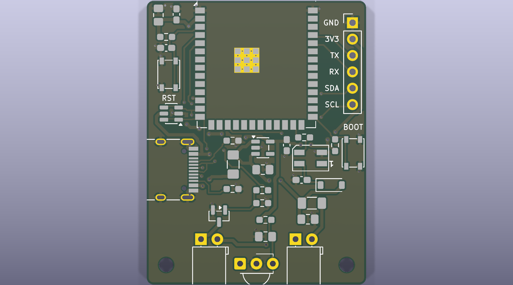
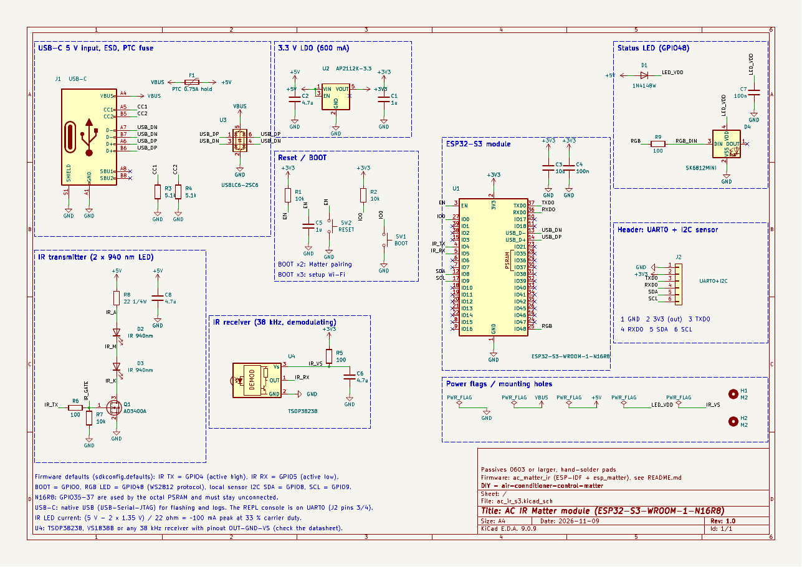

# Mạch in module IR máy lạnh – ESP32-S3-WROOM-1-N16R8 (KiCad 9)

Bo 2 lớp **34 × 44 mm**, cấp nguồn **USB-C 5 V**, có mắt phát và mắt thu hồng ngoại, chạy thẳng firmware
`ac_matter_ir` (cùng file `.bin` với bo DevKitC, không phải đổi cấu hình). Linh kiện dán từ **0603** trở lên,
pad loại hàn tay. Kể cả ăng-ten module chìa ra mép trên và đầu LED IR chìa ra mép dưới, cả cụm khoảng
35 × 53 mm.



| File | Nội dung |
|---|---|
| `ac_ir_s3.kicad_pro` / `.kicad_sch` / `.kicad_pcb` | Dự án KiCad 9 (mở bằng KiCad 9.0 trở lên) |
| `fab/ac_ir_s3_v1.0_gerbers.zip` | Gerber + file khoan, gửi cho xưởng mạch in |
| `fab/ac_ir_s3_v1.0_bom.csv` | Danh sách linh kiện (giá trị, thông số, mã hãng, mã LCSC) |
| `fab/ac_ir_s3_v1.0_cpl.csv` | Tọa độ đặt linh kiện (nếu đặt xưởng hàn SMT), gốc ở góc dưới-trái bo |
| `docs/ac_ir_s3_v1.0_schematic.pdf` / `.png` | Sơ đồ nguyên lý |
| `docs/ac_ir_s3_v1.0_assembly_top.pdf` | Bản vẽ lắp ráp: vị trí và tên từng linh kiện |
| `docs/ac_ir_s3_v1.0_top.png`, `_bottom.png` | Ảnh mặt trên / mặt dưới bo |
| `docs/ac_ir_s3_v1.0_erc.txt`, `_drc.txt` | Kết quả kiểm tra ERC / DRC |
| `gen/` | Script đã sinh ra sơ đồ, bo, đường mạch và các file trên |

## Kiểm tra thiết kế

- **ERC**: 0 lỗi, 0 cảnh báo.
- **DRC** (kèm so khớp sơ đồ – mạch in): 0 vi phạm, 0 chân chưa nối, 0 lệch giữa sơ đồ và bo.
- Luật thiết kế: khoảng hở 0,2 mm; đường tín hiệu 0,25 mm, USB 0,2 mm, nguồn 0,5 mm; via 0,6/0,3 mm
  (nguồn 0,8/0,4 mm); đồng cách mép bo 0,3 mm. Phủ đồng GND cả hai mặt.
- Lỗ nhỏ nhất **0,2 mm**: các via tản nhiệt có sẵn trong footprint module dưới pad GND. Đa số xưởng làm được;
  nếu xưởng không nhận lỗ 0,2 mm, báo lại để đổi.
- Bỏ qua cảnh báo "chữ in bị mép bo cắt": ăng-ten module, cổng USB-C và LED/mắt thu IR cố ý chìa ra ngoài mép,
  phần chữ in của chúng nằm ngoài bo thì không in.

## Mạch



| Khối | Linh kiện | Ghi chú |
|---|---|---|
| Nguồn vào | J1 USB-C 16 chân, R3/R4 5,1 kΩ (CC), F1 PTC 0,75 A, U3 USBLC6-2SC6 | Có dữ liệu USB (D+/D−) để nạp firmware và xem log |
| 3,3 V | U2 AP2112K-3.3 (600 mA), C2 4,7 µF, C1 1 µF, C3 10 µF + C4 100 nF sát chân 3V3 module | |
| ESP32-S3 | U1 ESP32-S3-WROOM-1-**N16R8**, R1 10 kΩ + C5 1 µF ở EN, R2 10 kΩ kéo lên GPIO0 | GPIO35–37 bỏ trống (PSRAM octal) |
| Phát IR | D2, D3: 2 LED IR 5 mm 940 nm **nối tiếp**, R8 22 Ω 1206, Q1 AO3400A, R6 100 Ω, R7 10 kΩ, C8 4,7 µF | (5 V − 2 × 1,35 V) / 22 Ω ≈ 100 mA đỉnh, sóng mang 38 kHz 33 % |
| Thu IR | U4 TSOP38238 / VS1838B, lọc nguồn R5 100 Ω + C6 4,7 µF | Chân **OUT – GND – VS**, nguồn 3,3 V |
| LED trạng thái | D4 SK6812MINI ở GPIO48, cấp 5 V qua D1 1N4148W (≈ 4,2 V) | Mức logic 3,3 V vẫn đủ ngưỡng cao của LED |
| Nút | SW1 **BOOT** (GPIO0), SW2 **RESET** (EN) | BOOT 2 lần: ghép Matter; 3 lần: Wi-Fi cấu hình |
| Header J2 (tùy chọn) | 1 GND · 2 3V3 · 3 TXD0 · 4 RXD0 · 5 SDA (GPIO8) · 6 SCL (GPIO9) | Console REPL (UART0) và cảm biến SHT3x/SHT4x |
| Cơ khí | H1, H2 lỗ M2 | |

Chân khớp cấu hình mặc định của firmware: IR TX = GPIO4 (mức cao = LED sáng), IR RX = GPIO5 (tích cực mức
thấp), BOOT = GPIO0, LED RGB = GPIO48, I2C SDA = GPIO8 / SCL = GPIO9.

Tiêu thụ: đỉnh khoảng 0,5 A (Wi-Fi phát ~350 mA + xung LED IR 100 mA). Dùng cốc sạc 5 V từ 1 A trở lên.

## Bố trí

- **Ăng-ten** của module chìa ra ngoài mép trên của bo. Không đặt kim loại, dây điện hay bo mạch khác trong
  khoảng 15 mm quanh ăng-ten, không cho vào hộp kim loại.
- **USB-C** ở mép trái.
- Mép dưới: **LED IR – mắt thu – LED IR**, cả ba nhìn ra ngoài cùng một hướng. Hướng mép này về phía máy lạnh;
  vỏ hộp cần cửa sổ trong suốt với hồng ngoại (hoặc khoét lỗ) trước LED và mắt thu.
- Mặt dưới gần như là mặt đồng GND liền.
- Header J2 ở mép phải, nút BOOT ở góc phải, nút RESET ở mép trái.

## Lắp ráp

1. Hàn linh kiện dán trước: U3, U2, Q1, D1, D4, các R/C, F1, nút bấm, rồi J1 (hàn chắc 4 chân vỏ), cuối cùng
   module U1. Pad GND giữa module nên hàn bằng khò hoặc bếp hàn; hàn tay thì vẫn chạy vì module còn GND ở
   chân 1 và 40.
2. Chú ý chiều: vạch catốt của D1; dấu chân 1 của D4 (góc vát); U2/U3/Q1 theo dấu chân 1 trên bản vẽ lắp ráp.
3. **LED IR**: chân dài (anốt) vào lỗ tròn, chân ngắn (catốt) vào lỗ vuông. Bẻ chân 90° cho LED nằm sát mặt
   bo, đầu LED chìa ra ngoài mép dưới (thân LED cao 3 mm tính tới tâm).
4. **Mắt thu**: lỗ vuông = OUT, giữa = GND, còn lại = VS, mặt cầu (vòm) quay ra mép bo. VS1838B và TSOP38238
   đúng thứ tự này; loại khác phải xem datasheet.
5. J2 chỉ hàn khi cần UART hoặc cảm biến.

Kiểm tra trước khi cắm: đo không chập giữa VBUS, +5V, 3V3 và GND. Cắm USB: 3V3 phải 3,3 V, LED trạng thái
sáng theo firmware.

## Nạp firmware

Cổng USB-C nối thẳng USB của ESP32-S3 (USB-Serial-JTAG), không cần mạch nạp rời.

1. Lần đầu (chip trống hoặc firmware treo): giữ **BOOT**, nhấn và nhả **RESET**, nhả BOOT → chế độ nạp.
   Windows nhận cổng COM "USB JTAG/serial debug unit".
2. Nạp như README firmware, ví dụ:

```bat
python -m esptool --chip esp32s3 -p COM5 -b 460800 write-flash 0x0 ac_matter_ir_v1.3.0_full_0x0.bin
```

3. Nhấn RESET để chạy. Log khởi động hiện trên chính cổng USB đó (`idf.py -p COM5 monitor`).

Console lệnh (ví dụ `secrets`) chạy trên UART0: nối bộ chuyển USB-UART 3,3 V vào J2 (GND–GND, TX bộ chuyển →
RXD0 chân 4, RX bộ chuyển → TXD0 chân 3). Mã ghép Matter cũng xem được trên trang Wi-Fi cấu hình
(BOOT 3 lần → `http://192.168.4.1` → Nhà thông minh).

## Đặt mạch

- Xưởng mạch in (JLCPCB, PCBWay…): tải `fab/ac_ir_s3_v1.0_gerbers.zip`; 2 lớp, FR-4 1,6 mm, đồng 1 oz.
- Đặt xưởng hàn SMT: thêm `fab/ac_ir_s3_v1.0_bom.csv` và `fab/ac_ir_s3_v1.0_cpl.csv`. Mã LCSC trong BOM chỉ để
  tham khảo, kiểm tra lại từng mã và xem lại chiều linh kiện ở bước xem trước của xưởng trước khi đặt. LED IR,
  mắt thu và header là linh kiện chân cắm, tự hàn.

## Tạo lại hoặc sửa thiết kế

Các file KiCad được sinh bằng script trong `gen/` (Python 3 có module `pcbnew` của KiCad 9, numpy):

| Script | Việc |
|---|---|
| `netdef.py` | Danh sách linh kiện và net (nguồn duy nhất cho sơ đồ và bo) |
| `make_sch.py` | Sinh sơ đồ nguyên lý `.kicad_sch` |
| `check_netlist.py` | So netlist KiCad xuất ra với `netdef.py` |
| `make_pcb.py` | Đặt linh kiện, viền bo, phủ đồng GND, chữ in |
| `project.py` | Luật thiết kế, lớp net (Default / Power / USB) |
| `route.py` | Đi dây tự động (lưới 0,05 mm, A* có thương lượng tắc nghẽn), via GND, đổ đồng |
| `fix_thermals.py` | Nối đặc vào mặt đồng những pad GND mà DRC báo thiếu nan nhiệt |
| `outputs.sh` | Chạy ERC/DRC rồi xuất Gerber, khoan, BOM, CPL, PDF, ảnh |
| `build.sh` | Chạy toàn bộ các bước trên theo thứ tự |

```bash
cd hardware/ac-ir-s3
PYTHON=/usr/bin/python3 gen/build.sh
```

Sau khi sinh, có thể mở và sửa trực tiếp trong KiCad 9 như dự án bình thường (sửa tay thì không chạy lại
`build.sh`, vì script sẽ ghi đè). Chạy lại `gen/outputs.sh` để xuất lại file sản xuất sau khi sửa.
