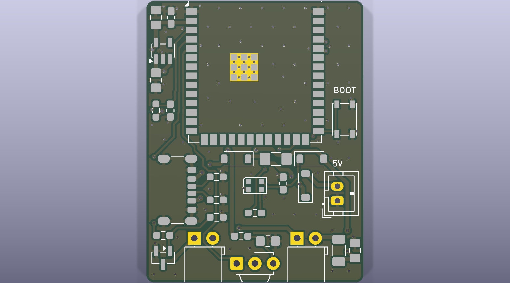
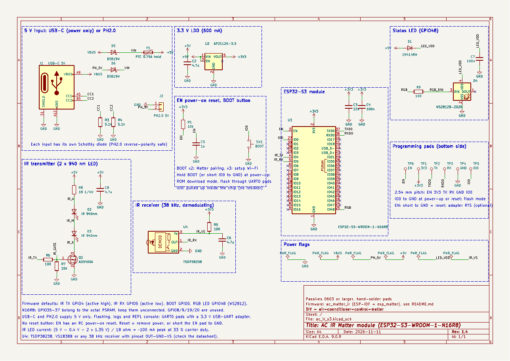

# Mạch in module IR máy lạnh – ESP32-S3-WROOM-1-N16R8 (KiCad 9)

Bo 2 lớp **30 × 39 mm**, cấp nguồn 5 V bằng **USB-C (chỉ cấp nguồn)** hoặc **đầu PH2.0** (GND, 5V), chỉ có nút
**BOOT**, nạp firmware qua **6 pad ở mặt dưới** (EN, 3V3, TX, RX, GND, IO0). Có 2 LED phát IR và mắt thu IR, chạy thẳng
firmware `ac_matter_ir` (cùng file `.bin` với bo DevKitC, không phải đổi cấu hình). Linh kiện dán từ **0603** trở
lên, pad loại hàn tay; riêng LED trạng thái D4 là WS2812B-2020 (2 × 2 mm, pad nằm dưới thân), nên hàn bằng khò
hoặc đặt xưởng hàn sẵn. Kể cả ăng-ten module chìa ra mép trên và đầu LED IR chìa ra mép dưới, cả cụm khoảng
31 × 49 mm.



**v1.4** (so với v1.3) – rà soát và tối ưu, firmware không đổi, cùng kích thước và vị trí cổng/LED:

| Thay đổi | Lý do |
|---|---|
| Lỗ via tản nhiệt dưới pad GND của module: 0,2 → **0,3 mm** (footprint riêng trong `ac_ir_s3.pretty`) | Bo 2 lớp giá rẻ (ví dụ JLCPCB) chỉ nhận lỗ via từ 0,3 mm. Lỗ nhỏ nhất trên bo giờ là 0,3 mm |
| **Via nối GND hai mặt** (68 via: lưới 3 mm, kể cả dưới module, cộng via cho từng mảng đồng bị cô lập) | Ở v1.3 các đường mặt dưới (+3V3, UART) cắt mặt GND thành mảng không nối được nên bị bỏ trống dưới module. Giờ mặt GND dưới liền, dòng hồi về đổi lớp ngay cạnh đường cắt |
| Bỏ **R2** (10 kΩ kéo lên GPIO0) | Chip tự kéo lên GPIO0 (khoảng 45 kΩ, mặc định lúc reset; sơ đồ mẫu của Espressif cũng không có điện trở này). Bỏ được đường +3V3 dài chạy ngang mặt dưới |
| Bỏ **C1** (1 µF ngõ ra LDO), **C3** 10 → **22 µF** | C3 nằm cách chân ra LDO 2,5 mm nên kiêm luôn tụ ngõ ra; 22 µF + 100 nF là giá trị datasheet module khuyên dùng cho xung dòng Wi-Fi |
| Thêm pad **EN** (TP6) cạnh pad 3V3 | Reset không cần rút điện (chập EN xuống GND), hoặc nối RTS của bộ chuyển để esptool tự reset. 5 pad cũ giữ nguyên vị trí |
| Pad GND nạp (TP4) có via riêng ngay cạnh, C2 nằm ngay dưới chân vào LDO, via GND của LDO nằm dưới thân | v1.3 nối pad GND bằng một đường 0,25 mm dài khoảng 13 mm; đường +3V3 ở mặt dưới giảm từ 44 mm xuống 22 mm |
| Kết quả đi dây lặp lại được | Chạy lại `gen/build.sh` cho đúng cùng một bo (trước đây thứ tự linh kiện phụ thuộc UUID ngẫu nhiên) |

Bớt 2 linh kiện phải hàn (R2, C1). Bản v1.4 **chưa được sản xuất hay đo thử**; bo v1.3 đã làm vẫn
dùng bình thường với cùng firmware.

**v1.3** (so với v1.2): LED trạng thái D4 đổi từ SK6812MINI (3,5 × 3,5 mm) sang **WS2812B-2020** (2 × 2 mm, LCSC
C965555), cùng giao thức và cùng chân nối, firmware không đổi.

**v1.2** (so với v1.1): bỏ header J2 cũ (UART + SDA/SCL), thay bằng 5 pad nạp ở mặt dưới; thêm đầu PH2.0 5 V;
mỗi nguồn vào đi qua một diode Schottky B5819W; bỏ 2 lỗ bắt vít; R8 còn 18 Ω (bù sụt áp diode); bo nhỏ từ
34 × 44 mm xuống 30 × 39 mm.

| File | Nội dung |
|---|---|
| `ac_ir_s3.kicad_pro` / `.kicad_sch` / `.kicad_pcb` | Dự án KiCad 9 (mở bằng KiCad 9.0 trở lên) |
| `fab/ac_ir_s3_v1.4_gerbers.zip` | Gerber + file khoan, gửi cho xưởng mạch in |
| `fab/ac_ir_s3_v1.4_bom.csv` | Danh sách linh kiện (giá trị, thông số, mã hãng, mã LCSC) |
| `fab/ac_ir_s3_v1.4_cpl.csv` | Tọa độ đặt linh kiện (nếu đặt xưởng hàn SMT), gốc ở góc dưới-trái bo |
| `docs/ac_ir_s3_v1.4_schematic.pdf` / `.png` | Sơ đồ nguyên lý |
| `docs/ac_ir_s3_v1.4_assembly_top.pdf` | Bản vẽ lắp ráp: vị trí và tên từng linh kiện |
| `docs/ac_ir_s3_v1.4_top.png`, `_bottom.png` | Ảnh mặt trên / mặt dưới bo |
| `docs/ac_ir_s3_v1.4_erc.txt`, `_drc.txt` | Kết quả kiểm tra ERC / DRC |
| `ac_ir_s3.pretty/`, `fp-lib-table` | Thư viện footprint của dự án: module với via tản nhiệt 0,3 mm |
| `gen/` | Script đã sinh ra sơ đồ, bo, đường mạch và các file trên |

## Kiểm tra thiết kế

- **ERC**: 0 lỗi, 0 cảnh báo.
- **DRC** (kèm so khớp sơ đồ – mạch in): 0 vi phạm, 0 chân chưa nối, 0 lệch giữa sơ đồ và bo.
- Luật thiết kế: khoảng hở 0,2 mm; đường tín hiệu 0,25 mm, nguồn 0,5 mm; via 0,6/0,3 mm (nguồn 0,8/0,4 mm); đồng
  cách mép bo 0,3 mm; cổ hẹp nhỏ nhất của mặt đồng GND 0,15 mm. Phủ đồng GND cả hai mặt, nối nhau bằng 84 via GND.
- Lỗ nhỏ nhất **0,3 mm** (104 lỗ via 0,3 mm, 13 lỗ 0,4 mm), nằm trong mức tối thiểu JLCPCB công bố cho bo 1–2
  lớp. Via được phủ sơn (tented), kể cả các via GND nằm dưới module.
- Còn một mảng đồng GND khoảng 2 mm² ở mặt dưới cạnh pad EN không có chỗ đặt via nên để trống (không ảnh hưởng).
- Bỏ qua cảnh báo "chữ in bị mép bo cắt": ăng-ten module, cổng USB-C và LED/mắt thu IR cố ý chìa ra ngoài mép,
  phần chữ in của chúng nằm ngoài bo thì không in.

## Mạch



| Khối | Linh kiện | Ghi chú |
|---|---|---|
| Nguồn vào | J1 USB-C 6 chân chỉ cấp nguồn (GCT USB4125-GF-A) + R3/R4 5,1 kΩ (CC); J2 PH2.0 2 chân (1 = GND, 2 = 5V); D5, D6 Schottky B5819W; F1 PTC 0,75 A | Dùng nguồn nào cũng được, cắm cả hai cùng lúc cũng không sao; cắm ngược cực PH2.0 thì diode chặn, không hỏng |
| 3,3 V | U2 AP2112K-3.3 (600 mA), C2 4,7 µF ở ngõ vào, C3 22 µF + C4 100 nF sát chân 3V3 module (C3 kiêm tụ ngõ ra LDO) | LDO tỏa khoảng (4,6 − 3,3) V × dòng, ước tính 0,1–0,2 W trung bình: ấm nhẹ là bình thường |
| ESP32-S3 | U1 ESP32-S3-WROOM-1-**N16R8**, R1 10 kΩ + C5 1 µF ở EN (tự reset khi cấp điện) | GPIO0 do chip tự kéo lên; GPIO35–37 bỏ trống (PSRAM octal); GPIO8/9/19/20 không dùng |
| Phát IR | D2, D3: 2 LED IR 5 mm 940 nm **nối tiếp**, R8 18 Ω 1206, Q1 AO3400A, R6 100 Ω, R7 10 kΩ, C8 4,7 µF | (5 V − 0,4 V − 2 × 1,35 V) / 18 Ω ≈ 100 mA đỉnh, sóng mang 38 kHz 33 %. Cần xa hơn: R8 = 10 Ω 1206 (≈ 170 mA đỉnh, ≈ 55 mA trung bình trong lúc phát, vẫn dưới mức 100 mA liên tục của LED) |
| Thu IR | U4 TSOP38238 / VS1838B, lọc nguồn R5 100 Ω + C6 4,7 µF | Chân **OUT – GND – VS**, nguồn 3,3 V |
| LED trạng thái | D4 WS2812B-2020 ở GPIO48, cấp từ 5 V qua D1 1N4148W (≈ 3,9 V) | Ở 3,9 V LED cần mức cao ≥ 0,7 × 3,9 ≈ 2,7 V: mức 3,3 V của ESP đủ |
| Nút | SW1 **BOOT** (GPIO0) | BOOT 2 lần: ghép Matter; 3 lần: Wi-Fi cấu hình; giữ BOOT khi cấp điện: chế độ nạp |
| Pad nạp (mặt dưới) | TP6 EN · TP1 3V3 · TP2 TX · TP3 RX · TP4 GND · TP5 IO0, cách nhau 2,54 mm | UART0 nạp firmware, xem log, console; IO0 sát GND để chập khi nạp; EN không bắt buộc |

Chân khớp cấu hình mặc định của firmware: IR TX = GPIO4 (mức cao = LED sáng), IR RX = GPIO5 (tích cực mức
thấp), BOOT = GPIO0, LED RGB = GPIO48. Cảm biến nhiệt độ dây (SDA/SCL) không còn trên bo; firmware mặc định đã
không dùng nên không cần đổi gì.

Tiêu thụ: đỉnh khoảng 0,5 A (Wi-Fi phát ~350 mA + xung LED IR 100 mA). Nguồn 5 V (cốc sạc USB hoặc nguồn nối
vào PH2.0) nên từ 1 A trở lên.

## Bố trí

- **Ăng-ten** của module chìa ra ngoài mép trên của bo. Không đặt kim loại, dây điện hay bo mạch khác trong
  khoảng 15 mm quanh ăng-ten, không cho vào hộp kim loại.
- **USB-C** ở mép trái; **PH2.0** (loại đứng, cắm từ trên xuống) ở phía phải, chữ "5V" in cạnh chân 5 V.
- Mép dưới: **LED IR – mắt thu – LED IR**, cả ba nhìn ra ngoài cùng một hướng. Hướng mép này về phía máy lạnh;
  vỏ hộp cần cửa sổ trong suốt với hồng ngoại (hoặc khoét lỗ) trước LED và mắt thu.
- Nút BOOT ở mép phải. Pad nạp ở mặt dưới, ngay dưới module.
- Không có lỗ bắt vít (để bo nhỏ nhất): giữ bo bằng rãnh trong vỏ hộp, keo hoặc băng dính 2 mặt ở mặt dưới
  (chừa pad nạp).

## Lắp ráp

1. Hàn **D4 trước tiên bằng khò** (khoảng 300 °C, có kem hàn, không quá 10 giây; WS2812B-2020 chịu nhiệt kém,
   pad nằm hết dưới thân nên mỏ hàn không với tới). Đặt xưởng hàn SMT thì bỏ qua bước này.
   Sau đó hàn: U2, Q1, D1, D5, D6, các R/C, F1, nút BOOT, rồi J1 (6 chân bước khoảng 1 mm, hàn
   chắc 4 chân vỏ), cuối cùng module U1. Pad GND giữa module nên hàn bằng khò hoặc bếp hàn; hàn tay thì vẫn chạy
   vì module còn GND ở chân 1 và 40. J1 là GCT USB4125-GF-A; dùng loại USB-C 6 chân SMD khác thì so vị trí chân
   và chân vỏ với bản vẽ lắp ráp trước khi mua.
2. Chú ý chiều: vạch catốt của D1, D5, D6; chân 1 của D4 theo dấu chân 1 trên bản vẽ lắp ráp (đối chiếu dấu chân 1 trên thân LED với datasheet WS2812B-2020); U2/Q1 theo dấu chân 1 trên bản vẽ lắp ráp.
3. **LED IR**: chân dài (anốt) vào lỗ tròn, chân ngắn (catốt) vào lỗ vuông. Bẻ chân 90° cho LED nằm sát mặt
   bo, đầu LED chìa ra ngoài mép dưới (thân LED cao 3 mm tính tới tâm).
4. **Mắt thu**: lỗ vuông = OUT, giữa = GND, còn lại = VS, mặt cầu (vòm) quay ra mép bo. VS1838B và TSOP38238
   đúng thứ tự này; loại khác phải xem datasheet.
5. **PH2.0**: chân 1 = GND, chân 2 = 5V (có chữ "5V" trên bo). Kiểm tra màu dây của jack trước khi cắm; cắm
   ngược thì bo không chạy nhưng không hỏng.
6. Pad nạp không cần hàn linh kiện.

Kiểm tra trước khi cắm: đo không chập giữa +5V, 3V3 và GND. Cắm nguồn: 3V3 phải 3,3 V, LED trạng thái sáng theo
firmware.

## Nạp firmware

Dùng bộ chuyển **USB-UART 3,3 V** (CP2102, CH340, FT232 đặt mức 3,3 V) nối vào pad mặt dưới (hàn dây, kẹp
pogo pin, hoặc tì một hàng rào đực 2,54 mm vào các pad; đồ gá 5 chân của v1.3 vẫn vừa, pad EN nằm thêm ở đầu
phía 3V3). Không có nút RESET: muốn khởi động lại thì ngắt điện rồi cấp lại, hoặc chập pad **EN** xuống GND một
cái.

| Bộ chuyển USB-UART | Pad trên bo |
|---|---|
| GND | GND |
| TX (TXD) | RX |
| RX (RXD) | TX |
| 3V3 | 3V3 – chỉ nối khi lấy nguồn từ bộ chuyển (xem dưới) |
| RTS, DTR (nếu bộ chuyển có) | RTS → EN, DTR → IO0: không bắt buộc, để esptool tự vào chế độ nạp và tự reset (cách nối thông dụng của ESP32, chưa thử trên bo này) |

Nguồn khi nạp, chọn một trong hai:
- Cấp 5 V qua USB-C hoặc PH2.0, **không** nối chân 3V3 của bộ chuyển (cách nên dùng).
- Lấy 3,3 V từ bộ chuyển vào pad 3V3, không cắm USB-C/PH2.0. Bộ chuyển phải có ổn áp 3,3 V từ 300 mA trở lên
  (loại CH340 có AMS1117); CP2102/FT232 thường không đủ dòng.

1. **Chập pad IO0 với pad GND** (nhíp, giọt thiếc hoặc dây nối; hai pad nằm sát nhau) hoặc giữ nút BOOT, rồi cấp
   điện. ESP32-S3 vào chế độ nạp. Bỏ chập sau khi đã cấp điện.
2. Nạp bằng cổng COM của bộ chuyển, ví dụ (đổi `COM7`):

```bat
python -m esptool --chip esp32s3 -p COM7 -b 460800 write-flash 0x0 ac_matter_ir_v1.6.0_full_0x0.bin
```

   Nâng cấp bo đã có dữ liệu thì cập nhật trên trang cấu hình (mục Cập nhật firmware) hoặc nạp file app ở
   `0x40000` như README firmware. Bộ chuyển nào lỗi ở 460800 thì dùng `-b 115200`. Dòng "Hard resetting via RTS
   pin" cuối cùng chỉ có tác dụng khi RTS đã nối vào pad EN.
3. Ngắt điện rồi cấp lại, hoặc chập EN xuống GND (IO0 không còn chập), để chạy firmware mới.
4. Log và console lệnh (ví dụ `secrets`): `idf.py -p COM7 monitor` hoặc PuTTY 115200 8N1 trên cùng bộ chuyển.
   Muốn xem log từ lúc khởi động thì mở monitor trước rồi mới cấp điện.

Nếu không vào được chế độ nạp: rút bộ chuyển khỏi máy tính, chập IO0–GND và cấp điện cho bo trước, rồi mới cắm
bộ chuyển. Mã ghép Matter cũng xem được mà không cần UART: trang Wi-Fi cấu hình (BOOT 3 lần →
`http://192.168.4.1` → Nhà thông minh).

## Đặt mạch

- Xưởng mạch in (JLCPCB, PCBWay…): tải `fab/ac_ir_s3_v1.4_gerbers.zip`; 2 lớp, FR-4 1,6 mm, đồng 1 oz.
- Đặt xưởng hàn SMT: thêm `fab/ac_ir_s3_v1.4_bom.csv` và `fab/ac_ir_s3_v1.4_cpl.csv`. Mã LCSC trong BOM chỉ để
  tham khảo, kiểm tra lại từng mã và xem lại chiều linh kiện ở bước xem trước của xưởng trước khi đặt. LED IR,
  mắt thu và PH2.0 là linh kiện chân cắm, tự hàn. 6 pad nạp chỉ là đồng trên bo, không có trong BOM.

## Tạo lại hoặc sửa thiết kế

Các file KiCad được sinh bằng script trong `gen/` (Python 3 có module `pcbnew` của KiCad 9, numpy):

| Script | Việc |
|---|---|
| `netdef.py` | Danh sách linh kiện, net, kích thước bo (nguồn duy nhất cho sơ đồ và bo) |
| `local_lib.py` | Ghi thư viện footprint của dự án (`ac_ir_s3.pretty`: module với via tản nhiệt 0,3 mm) và `fp-lib-table` |
| `make_sch.py` | Sinh sơ đồ nguyên lý `.kicad_sch` |
| `check_netlist.py` | So netlist KiCad xuất ra với `netdef.py` |
| `make_pcb.py` | Đặt linh kiện, viền bo, phủ đồng GND, chữ in |
| `project.py` | Luật thiết kế, lớp net (Default / Power) |
| `route.py` | Đi dây tự động (lưới 0,05 mm, A* có thương lượng tắc nghẽn), via GND cho từng pad, via nối hai mặt GND, đổ đồng |
| `fix_thermals.py` | Nối đặc vào mặt đồng những pad GND mà DRC báo thiếu nan nhiệt |
| `outputs.sh` | Chạy ERC/DRC rồi xuất Gerber, khoan, BOM, CPL, PDF, ảnh |
| `build.sh` | Chạy toàn bộ các bước trên theo thứ tự |

```bash
cd hardware/ac-ir-s3
PYTHON=/usr/bin/python3 gen/build.sh
```

Sau khi sinh, có thể mở và sửa trực tiếp trong KiCad 9 như dự án bình thường (sửa tay thì không chạy lại
`build.sh`, vì script sẽ ghi đè). Chạy lại `gen/outputs.sh` để xuất lại file sản xuất sau khi sửa.
